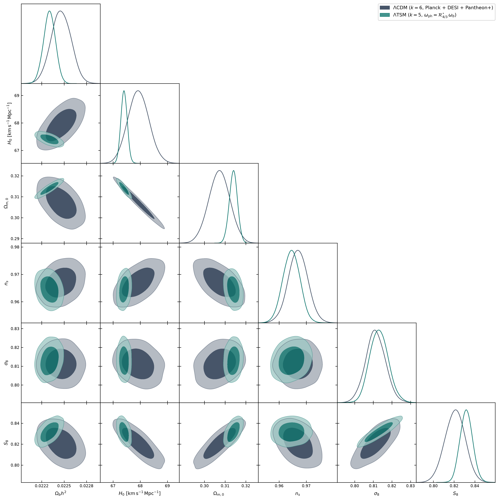

# The Topological Saturation Model (ΛTSM) & Redshift-Dependent RAR

[-10.5281%2Fzenodo.23293328-blue.svg)](https://doi.org/10.5281/zenodo.23293328)
[-10.5281%2Fzenodo.23077417-blue.svg)](https://doi.org/10.5281/zenodo.23077417)

[-success.svg)](https://github.com/lesgourg/class_public)

**Author:** Tomer Haimovich ([ORCID: 0009-0002-1536-1397](https://orcid.org/0009-0002-1536-1397))  
**Preprints & Permanent Concept Archives (Current Release: Version 9.0 — November 25, 2026):**
* **Part I (Strong Lensing, Disk Kinematics & 3D Dwarf Spheroidals — V9.0):** [`Part_I_Topological_Saturation_of_Spatial_Metrics_V9.pdf`](./Part_I_Topological_Saturation_of_Spatial_Metrics_V9.pdf) — *Testing a Cosmologically Anchored, Redshift-Dependent Radial Acceleration Scale Across Strong Lensing, Disk Kinematics, and 3D Dwarf Spheroidals* — [DOI: 10.5281/zenodo.23293328](https://doi.org/10.5281/zenodo.23293328) *(always resolves to latest version)*
* **Part II (Clean Covariant DBI Cosmology & Full Cobaya MCMC Audit — V9.0):** [`Part_II_The_Topological_Saturation_Model_V9.pdf`](./Part_II_The_Topological_Saturation_Model_V9.pdf) — *The Topological Saturation Model (ΛTSM): Clean Covariant DBI Cosmology and Full Cobaya MCMC Audit (Planck 2018 + DESI BAO + Pantheon+)* — [DOI: 10.5281/zenodo.23077417](https://doi.org/10.5281/zenodo.23077417) *(always resolves to latest version)*

---

## Executive Summary

Standard six-parameter cosmology ($\Lambda\text{CDM}$) introduces Cold Dark Matter (CDM) as an unconstrained free parameter ($\omega_{\text{cdm}} = 0.12000 \pm 0.00120$ in Planck 2018) alongside hundreds of per-galaxy dark-halo parameters across galactic kinematics and lensing catalogs.

This repository provides the Version 9.0 companion manuscripts, C source code modifications for the **CLASS Boltzmann solver (`v3.4.0`)**, converged four-run **`Cobaya` MCMC** audit pipelines (**Planck 2018 + DESI 2024 BAO + Pantheon+**), and Python verification scripts for the **Topological Saturation Model ($\Lambda\text{TSM}$)**. Formulated as a nested five-parameter ($k = 5$, $\Delta k = -1$) sub-model within the minimally coupled, shift-symmetric Horndeski $G_2(X)$ **Dirac–Born–Infeld (DBI)** class, the kinetically saturated condensate ($M \lesssim 0.10\text{ meV}$, $V = 0$, $\gamma(a) = \sqrt{1 + (a_*/a)^6} \gg 1$) evolves with $w_{\text{eff}} = \gamma^{-1} \to 0$ and $c_s^2 = \gamma^{-2} \to 0$ ($r_{s,\phi}(0) \lesssim 16\text{ kpc}$), preserving exact separate covariant conservation ($\nabla^\mu T_{\mu\nu} = 0$) and luminal tensor speed ($c_T = c$). Anchoring the redshift-dependent Radial Acceleration Relation (RAR) scale $a_0(z) = cH(z)/\mathcal{R}^\circ_{4/3}$ directly to this cosmological baseline links early-universe CMB/BAO/SNe observations to five independent galactic archives (**SLACS**, **Euclid DR1 ECLIPSE**, **MUSE-DARK III**, **SPARC**, and **LVDB**) with **0% particle Cold Dark Matter and ZERO free dark-matter parameters ($k_{\text{dark}} = 0$)**.

---

## 1. First-Principles Covariant Formulation (Zero Free Parameters)

We model the clean covariant cosmological sector of $\Lambda\text{TSM}$ via the minimally coupled, shift-symmetric Horndeski $G_2(X)$ Einstein–Dirac–Born–Infeld action ($V = 0$):

$$S = \int d^4x \sqrt{-g} \left[ \frac{R - 2\Lambda}{16\pi G} - M^4\sqrt{1 - \frac{2|X|}{M^4}} + M^4 + \mathcal{L}_m(\psi_m, g_{\mu\nu}) \right]$$

where $X \equiv -\frac{1}{2}g^{\mu\nu}\nabla_\mu\phi\nabla_\nu\phi$, and the relativistic DBI saturation factor is $\gamma(a) = \sqrt{1 + (a_*/a)^6} \gg 1$. Every governing constant across cosmic epochs is fixed by a single structural postulate ($\mathcal{R}^\circ_{4/3}$):

| Physical Regime | Exact Analytical Relation | Numerical Value | Structural / Covariant Origin |
| :--- | :--- | :--- | :--- |
| **Structural Density Ratio** | $\mathcal{R}^\circ_{4/3} \equiv \frac{\omega_{\text{phantom}}}{\omega_b} = \frac{16}{3}\left(1 + \frac{1}{16\pi^2}\right)$ | $\approx 5.3671$ ($5.367107$) | Single structural postulate eliminating $\omega_{\text{cdm}}$ ($\Delta k = -1$) |
| **Derived Phantom Density** | $\omega_{\text{phantom}} = \mathcal{R}^\circ_{4/3}\,\omega_b$ | $0.120062$ | Evaluated at Planck $\omega_b = 0.02237$ (0% particle CDM; not a $w < -1$ ghost) |
| **DBI Saturated Limit** | $M \lesssim 0.10\text{ meV},\; V = 0,\; \gamma(a) = \sqrt{1 + (a_*/a)^6} \gg 1$ | $w_{\text{eff}} = \gamma^{-1} \to 0,\; c_s^2 = \gamma^{-2} \to 0$ | Causal, ghost-free condensate ($r_{s,\phi}(0) \lesssim 16\text{ kpc}$); $\nabla^\mu T_{\mu\nu} = 0$, $c_T = c$ |
| **Redshift-Dependent RAR Scale** | $a_0(z) = \frac{cH(z)}{\mathcal{R}^\circ_{4/3}} = a_0(0)\sqrt{\Omega_{m,0}(1+z)^3 + \Omega_\Lambda}$ | Dynamic with $z$ | Cosmologically anchored to flat DBI baseline ($H_0 = 67.36\text{ km s}^{-1}\text{ Mpc}^{-1}$, $\Omega_{m,0} = 0.31391$) |
| **Present-Day RAR Scale ($z = 0$)** | $a_0(0) = \frac{cH_0}{\mathcal{R}^\circ_{4/3}}$ | $1.2194 \times 10^{-10}\text{ m s}^{-2}$ | Unscaled across disks, lenses, and 3D dSphs (golden-ratio scaling & flattening gates ruled out) |
| **RAR Interpolation Function** | $\nu(y) = \left[1 - \exp\left(-\sqrt{y}\right)\right]^{-1}$ | Single prescription | Zero per-galaxy tuning across 5 independent galactic archives |

---

## 2. Part II: Clean Covariant DBI Cosmology & Full Cobaya MCMC Audit (`Part_II_The_Topological_Saturation_Model_Package`)

In `Part_II_The_Topological_Saturation_Model_Package/`, the clean covariant DBI condensate is implemented directly inside **`CLASS v3.4.0`** with **0% particle CDM**, exact separate covariant conservation ($\nabla^\mu T_{\mu\nu} = 0$), and luminal tensor propagation ($c_T = c$):

$$w_{\text{eff}}(a) = \gamma(a)^{-1} \to 0, \qquad c_s^2(a) = \gamma(a)^{-2} \to 0 \quad \left(r_{s,\phi}(0) \lesssim 16\text{ kpc}\right), \qquad \omega_{\text{phantom}} = \mathcal{R}^\circ_{4/3}\,\omega_b = \frac{16}{3}\left(1 + \frac{1}{16\pi^2}\right)\omega_b$$

### Quantitative Results: `CLASS v3.4.0` Baseline & Converged Four-Run `Cobaya` MCMC Audit ($R - 1 < 0.008$, $\Sigma m_\nu = 0.06\text{ eV}$, $\Delta k = -1$)

| Observable / Statistic | Planck 2018 $\Lambda\text{CDM}$ ($k=6$) | $\Lambda\text{TSM}$ `CLASS v3.4.0` Baseline (0% CDM) | $\Lambda\text{TSM}$ `Cobaya` Planck 2018 Alone ($k=5$, $N=623$) | $\Lambda\text{TSM}$ `Cobaya` Joint: Planck + DESI 2024 BAO + Pantheon+ ($k=5$, $N=2{,}225$) |
| :--- | :---: | :---: | :---: | :---: |
| $\omega_{\text{cdm}}$ or $\omega_{\text{phantom}}$ | $0.12000 \pm 0.00120$ (Free) | **$0.120062$** (at $\omega_b = 0.02237$) | Derived via $\mathcal{R}^\circ_{4/3}\omega_b$ | Derived via $\mathcal{R}^\circ_{4/3}\omega_b$ |
| $H_0$ [$\text{km s}^{-1}\text{ Mpc}^{-1}$] | $67.36 \pm 0.54$ | $67.36$ | — | **$67.41 \pm 0.12$** |
| $\Omega_{m,0}$ | $0.3153 \pm 0.0073$ | $0.31391$ | — | **$0.3140 \pm 0.0020$** |
| Undiluted Wishart $\Delta\chi^2_W$ / $R^2_{TT}$ | $0.0000$ / $1.000000$ (Ref.) | **$\Delta\chi^2_W = 0.1446$ ($R^2_{TT} = 1.000000$)** | — | — |
| BBN Deviation $\Delta H/H$ ($z = 10^9$) | $0.00000\%$ | **$0.00000\%$** | **$0.00000\%$** | **$0.00000\%$** |
| $\Delta\chi^2_{\text{MAP}}$ vs. $\Lambda\text{CDM}$ | $0.00$ (Ref.) | — | **$\approx 0.00$** | **$+2.10$** |
| $\Delta\text{AIC}$ ($\Delta k = -1$) | $0.00$ (Ref.) | — | **$\approx -2.00$** | **$[+0.10,\; +0.74]$** |
| $\Delta\text{BIC}$ ($\Delta k = -1$) | $0.00$ (Ref.) | — | **$\approx -6.43$** | **$[-5.61,\; -4.96]$** |
| **Free Dark Matter Parameters ($k_{\text{dark}}$)** | **1 ($\omega_{\text{cdm}}$)** | **0** | **0** | **0** |

### Diagnostic Visualizations (`./Part_II_The_Topological_Saturation_Model_Package/`)

| Full CMB ($TT, TE, EE$) & $P(k)$ Audit (`CLASS v3.4.0`, 0% CDM) | Primordial BBN Expansion Proof ($z = 0 \to 10^9$, $\Delta H/H = 0.00000\%$) |
| :---: | :---: |
|  |  |

| Converged 5-Parameter `Cobaya` MCMC Corner Plot (Planck + DESI 2024 + Pantheon+) | $\mathcal{R}^\circ_{4/3}$ Structural Ratio Falsifiability Audit (`Cobaya`) |
| :---: | :---: |
|  |  |

---

## 3. Part I: Redshift-Dependent RAR Audit Across Five Independent Galactic Archives (`Part_I_Topological_Saturation_of_Spatial_Metrics_Package`)

Coupling the single cosmologically anchored scale $a_0(z) = cH(z)/\mathcal{R}^\circ_{4/3} = a_0(0)\sqrt{\Omega_{m,0}(1+z)^3 + \Omega_\Lambda}$ ($a_0(0) = 1.2194 \times 10^{-10}\text{ m s}^{-2}$) to $\nu(y) = [1 - \exp(-\sqrt{y})]^{-1}$ with zero dark matter and zero per-galaxy tuning yields the following V9.0 audit across five independent archives (with relativistic lensing and cluster-scale boundaries explicitly delineated):

| # | Independent Archive | Sample & Regime | V9.0 Empirical Audit Result (Zero Free Parameters) |
| :---: | :--- | :--- | :--- |
| **1** | **SLACS** (SLACS IX & S4TM) | $N = 110$ Grade-A early-type strong lenses (exact line-of-sight geodesic integration, Jaffe profile, $d_L^2$-rescaled masses) | Dynamic $a_0(z_d)$ achieves strict 1:1 parity **$R^2_{1:1} = 0.8103$** on SLACS IX ($N = 70$, matching the $0.08\text{ dex}$ HST noise ceiling) and **$R^2_{1:1} = 0.8090$** across $N = 110$. |
| **2** | **Euclid DR1 ECLIPSE** | $N = 1{,}095$ Grade-A strong lenses ($z_d \in [0.10, 1.50]$) + forward Monte Carlo ($N_{\text{MC}} = 500/\text{scenario}$, up to $0.20\text{ dex}$ mass & $5\%$ photo-$z$ scatter) | Dynamic $a_0(z_d)$ reduces geometrically impossible lensing failures relative to static MOND by **$23.1\%$ overall** and **$50\%$ at $z_d \ge 0.70$**; MC propagation confirms this advantage in **$100\%$ of realizations** across all bins while isolating a low-$z$ group-scale transition ($\theta_E \ge 1.3''$). |
| **3** | **MUSE-DARK III** | $N = 79$ intermediate-$z$ rotating disks ($0.33 < z < 1.44$) | $a_0(z)$ matches the self-consistent MOND RAR at $z \sim 1$ within **$0.4\%$** ($2.180$ vs. $2.19^{+0.12}_{-0.10} \times 10^{-10}\text{ m s}^{-2}$) and fits the 4-bin redshift evolution ($\chi^2 = 4.37$, **$p = 0.359$** vs. $p < 10^{-6}$ for static MOND). |
| **4** | **SPARC** | $N = 175$ late-type spiral galaxies (clean rotation curves & direct-distance BTFR) | Unscaled $a_0(0)$ achieves **$R^2_{1:1} = 0.9331$** (clean rotation curves) and **$R^2_{1:1} = 0.8832$** (direct-distance BTFR), **disfavoring golden-ratio scaling**. |
| **5** | **LVDB** | $N = 158$ 3D dwarf spheroidal galaxies (dSphs) | **$0.1600\text{ dex}$** dispersion RMS in external dSphs, **ruling out morphological flattening gates**. |

### Late-Universe Empirical Figures (`./Part_I_Topological_Saturation_of_Spatial_Metrics_Package/`)

| SLACS 110 Strong Lenses ($R^2_{1:1} = 0.8090$; SLACS IX $0.8103$) | SPARC 175 Disks — Unscaled $a_0(0)$ ($R^2_{1:1} = 0.9331$ / BTFR $0.8832$) |
| :---: | :---: |
|  |  |

| LVDB 158 3D Dwarf Spheroidals ($0.1600\text{ dex}$ RMS) | SLACS + SPARC Stiffness & HST Noise-Floor Audit |
| :---: | :---: |
|  |  |

---

## 4. Reproducibility & Step-by-Step Execution Guide

All empirical datasets, modified `CLASS v3.4.0` C files, `Cobaya` MCMC configurations/chains, and standalone Python audit scripts are bundled directly inside `Part_I_Topological_Saturation_of_Spatial_Metrics_Package/` and `Part_II_The_Topological_Saturation_Model_Package/` (each folder also includes its own package-level `README.md`).

### Prerequisites

<pre><code>pip install numpy scipy pandas matplotlib openpyxl cython cobaya getdist</code></pre>

### A. Reproduce Part I Galactic & Lensing Audits (`Part_I_Topological_Saturation_of_Spatial_Metrics_Package`)

<pre><code>cd Part_I_Topological_Saturation_of_Spatial_Metrics_Package

# 1. Verify SLACS 110 Strong Lenses (exact geodesic integration, Jaffe profile; SLACS IX R^2_1:1 = 0.8103, Full N=110 R^2_1:1 = 0.8090)
python SLACS_110_Code_v5.py

# 2. Verify Euclid DR1 ECLIPSE Grade-A Lenses (N = 1,095) & Forward Monte Carlo Audit (N_MC = 500/scenario)
python run_eclipse_golden_test_v2.py
python run_eclipse_mc_uncertainty_audit.py

# 3. Verify MUSE-DARK III Intermediate-z Disks (0.33 < z < 1.44, N = 79; chi^2 = 4.37, p = 0.359)
python MUSE_DARK_III_Audit.py

# 4. Verify SPARC 175 Disks (unscaled a0(0): clean RC R^2_1:1 = 0.9331, direct-distance BTFR R^2_1:1 = 0.8832)
python SPARC_Unified_Audit_v5.py

# 5. Verify LVDB 158 3D Dwarf Spheroidals (0.1600 dex RMS; ruling out morphological flattening gates)
python LVDB_Morphology_Audit_v5.py

# 6. Verify Combined SLACS + SPARC Stiffness & HST 0.08 dex Noise-Floor Audit
python SLACS_SPARC_Stiffness_NoiseFloor_v6.py</code></pre>

### B. Reproduce Part II `CLASS v3.4.0` Boltzmann & `Cobaya` MCMC Audits (`Part_II_The_Topological_Saturation_Model_Package`)

<pre><code># 1. Clone official CLASS v3.4.0 and inject the clean covariant DBI C modules
git clone https://github.com/lesgourg/class_public.git
cd class_public
cp ../Part_II_The_Topological_Saturation_Model_Package/source/background.c source/background.c
cp ../Part_II_The_Topological_Saturation_Model_Package/source/perturbations.c source/perturbations.c

# 2. Compile CLASS and its Python wrapper (classy)
make clean && make -j4
cd python && python setup.py install --user && cd ../../Part_II_The_Topological_Saturation_Model_Package

# 3. Verify classy Consistency, Planck 2018 Wishart Audit (dChi^2_W = 0.1446, R^2_TT = 1.000000) & BBN Proof (dH/H = 0.00000%)
python 00_test_classy_consistency.py
python audit_phantom_full.py
python phase1_calibrate_and_bbn.py

# 4. Run & Analyze the Converged Four-Run Cobaya MCMC Audit (Planck 2018 + DESI 2024 BAO + Pantheon+)
bash 01_setup_cobaya_ubuntu.sh
bash 02_run_all_chains.sh
python 03_analyze_cobaya_results.py
python 04_regenerate_clean_figures.py</code></pre>

---

## Citation

If you use this code, data, or theoretical framework in your research, please cite the permanent Concept DOIs (which always resolve to the latest release, currently Version 9.0):

<pre><code>@article{Haimovich2026_Part1,
  author  = {Haimovich, Tomer},
  title   = {Testing a Cosmologically Anchored, Redshift-Dependent Radial Acceleration Scale Across Strong Lensing, Disk Kinematics, and 3D Dwarf Spheroidals},
  year    = {2026},
  month   = nov,
  note    = {Concept DOI (always resolves to latest version; currently Version 9.0)},
  doi     = {10.5281/zenodo.23293328},
  url     = {https://doi.org/10.5281/zenodo.23293328}
}

@article{Haimovich2026_Part2,
  author  = {Haimovich, Tomer},
  title   = {The Topological Saturation Model ($\Lambda$TSM): Clean Covariant DBI Cosmology and Full Cobaya MCMC Audit (Planck 2018 + DESI BAO + Pantheon+)},
  year    = {2026},
  month   = nov,
  note    = {Concept DOI (always resolves to latest version; currently Version 9.0)},
  doi     = {10.5281/zenodo.23077417},
  url     = {https://doi.org/10.5281/zenodo.23077417}
}</code></pre>
