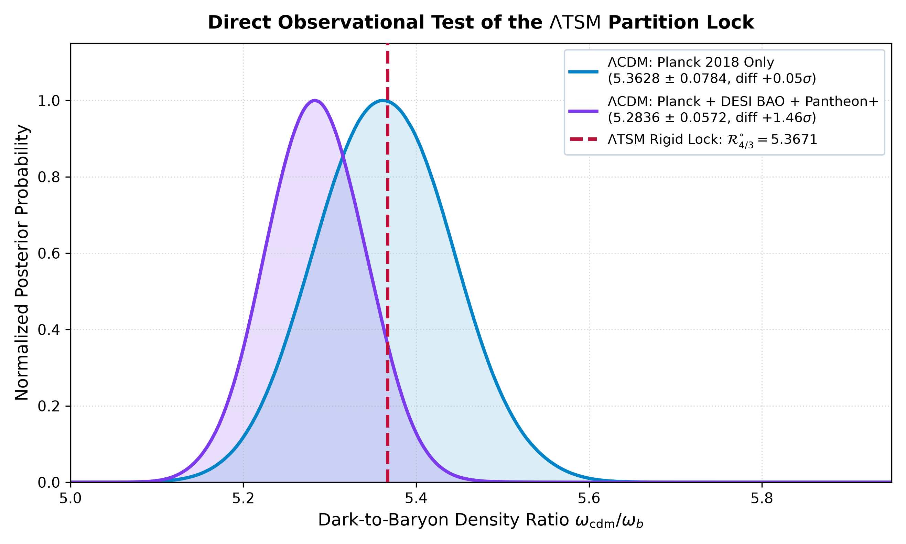
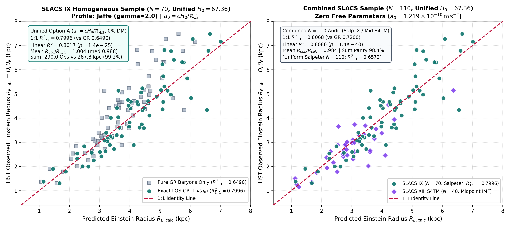
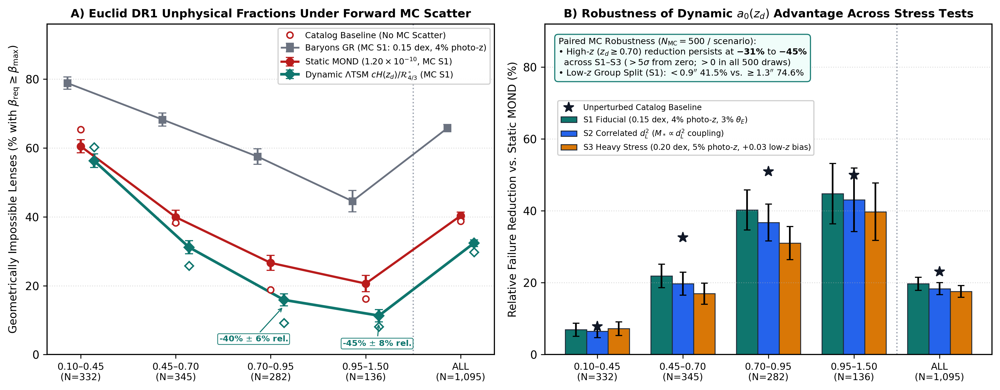
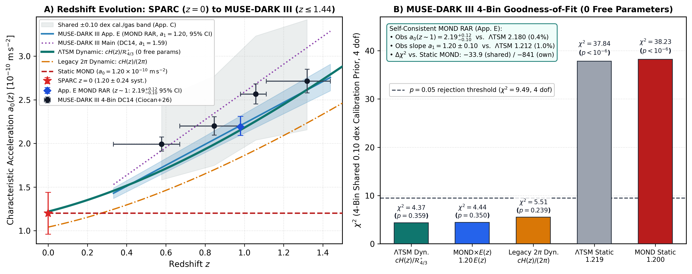
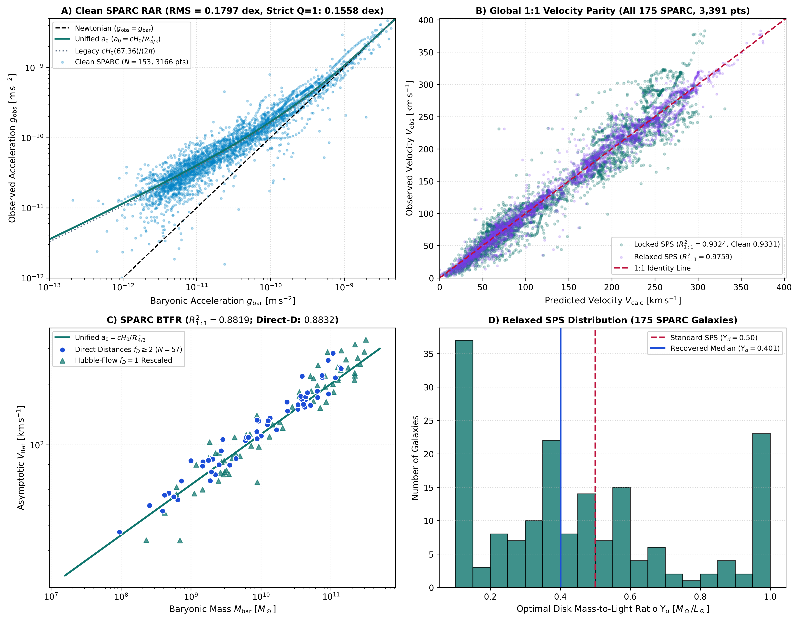
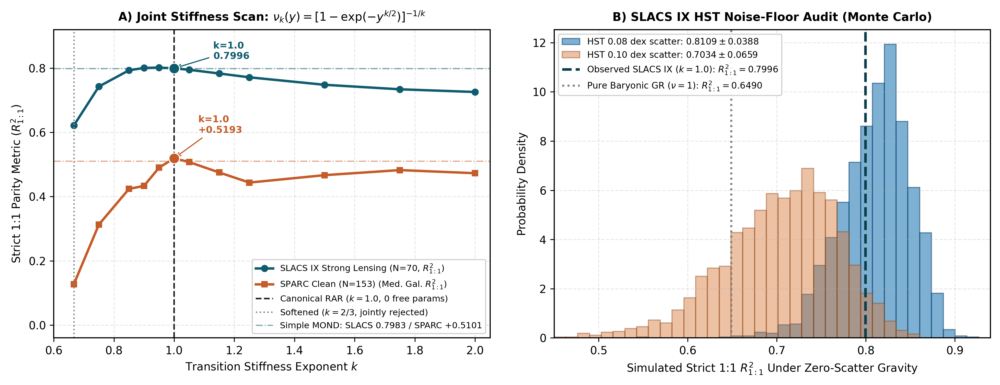

# The Topological Saturation Model (ΛTSM) & Redshift-Dependent RAR

[-10.5281%2Fzenodo.23293328-blue.svg)](https://doi.org/10.5281/zenodo.23293328)
[-10.5281%2Fzenodo.23077417-blue.svg)](https://doi.org/10.5281/zenodo.23077417)
[](https://orcid.org/0009-0002-1536-1397)
[-success.svg)](https://github.com/lesgourg/class_public)
[](https://cobaya.readthedocs.io/)
[](https://www.python.org/)
[](#)

**Author:** Tomer Haimovich ([ORCID: 0009-0002-1536-1397](https://orcid.org/0009-0002-1536-1397)) | **Contact:** tomerhaimovich@gmail.com  
**Current Release:** Part I Version 10 (November 28, 2026) & Part II Version 9 (November 25, 2026) *(All Zenodo links below use permanent Concept DOIs that always resolve to the latest release)*

* **Part I — Galactic Lensing, Disk Kinematics & 3D Dwarf Spheroidals (V10):**  
  *Testing a Cosmologically Anchored, Redshift-Dependent Radial Acceleration Scale Across Strong Lensing, Disk Kinematics, and 3D Dwarf Spheroidals*  
  PDF: [`Part_I_Topological_Saturation_of_Spatial_Metrics_V10.pdf`](./Part_I_Topological_Saturation_of_Spatial_Metrics_V10.pdf) | Package: [`Part_I_Topological_Saturation_of_Spatial_Metrics_Package/`](./Part_I_Topological_Saturation_of_Spatial_Metrics_Package/README.md) | Concept DOI: [10.5281/zenodo.23293328](https://doi.org/10.5281/zenodo.23293328)
* **Part II — Clean Covariant DBI Cosmology & Full `Cobaya` MCMC Audit (V9):**  
  *The Topological Saturation Model (ΛTSM): Clean Covariant DBI Cosmology and Full Cobaya MCMC Audit (Planck 2018 + DESI BAO + Pantheon+)*  
  PDF: [`Part_II_The_Topological_Saturation_Model_V9.pdf`](./Part_II_The_Topological_Saturation_Model_V9.pdf) | Package: [`Part_II_The_Topological_Saturation_Model_Package/`](./Part_II_The_Topological_Saturation_Model_Package/README.md) | Concept DOI: [10.5281/zenodo.23077417](https://doi.org/10.5281/zenodo.23077417)

---

## Executive Summary

Standard six-parameter ΛCDM cosmology introduces Cold Dark Matter (CDM) as an unconstrained free parameter ($`\omega_{\mathrm{cdm}} = 0.12000 \pm 0.00120`$ in Planck 2018) alongside hundreds of per-galaxy halo parameters across galactic dynamics and strong-lensing catalogs.

This repository hosts the companion manuscripts (**Part I V10** and **Part II V9**), clean covariant C modifications for **`CLASS v3.4.0`**, a converged four-run real-likelihood **`Cobaya` MCMC** suite (**Planck 2018 + DESI 2024 BAO + Pantheon+**), standalone Python verification pipelines, and an interactive Excel workbench for the **Topological Saturation Model (ΛTSM)**. Formulated as a nested five-parameter ($`k = 5`$, $`\Delta k = -1`$) sub-model within the minimally coupled, shift-symmetric Horndeski $`G_2(X)`$ **Dirac–Born–Infeld (DBI)** class, the ghost-free, kinetically saturated condensate ($`M \lesssim 0.10`$ meV, $`V = 0`$, $`\gamma(a) = \sqrt{1 + (a_*/a)^6} \gg 1`$) evolves in its dust-like limit ($`w_{\mathrm{eff}} = \gamma^{-1} \to 0`$, $`c_s^2 = \gamma^{-2} \to 0`$, $`r_{s,\phi}(0) \lesssim 16`$ kpc, $`k_J(0) \gtrsim 15.4`$ Mpc⁻¹) with exact separate covariant conservation ($`\nabla^\mu T_{\mu\nu} = 0`$) and luminal tensor propagation ($`c_T = c`$). Eliminating $`\omega_{\mathrm{cdm}}`$ via a single phenomenological postulate, $`\mathcal{R}_{4/3}^{\circ} \equiv \omega_{\mathrm{phantom}}/\omega_b = \frac{16}{3}\left(1 + \frac{1}{16\pi^2}\right) \approx 5.36710706`$, and anchoring the galactic Radial Acceleration Relation (RAR) scale to $`a_0(z) = cH(z)/\mathcal{R}_{4/3}^{\circ}`$ links precision CMB/BAO/SNe cosmology directly to **five independent galactic archives** (**SLACS**, **Euclid DR1 ECLIPSE**, **MUSE-DARK III**, **SPARC**, and **LVDB**) without per-galaxy dark-matter halo parameters.

> **Terminological Note:** $`\omega_{\mathrm{phantom}}`$ ($`\rho_\phi`$) denotes **neither** a phantom ghost field ($`w < -1`$) **nor** a non-baryonic dark matter particle; it represents the covariant gravitational energy density of the ghost-free, shift-symmetric DBI condensate in its causal dust-like limit ($`0 < c_s^2 < 1`$).

---

## 1. Shared Covariant Baseline & Cross-Scale Lock

In natural units ($`\hbar = c = 1`$), the minimally coupled, shift-symmetric Horndeski $`G_2(X)`$ Einstein–DBI cosmological action ($`V(\phi) = 0`$, timelike branch $`X \equiv -\frac{1}{2}g^{\mu\nu}\nabla_\mu\phi\nabla_\nu\phi > 0`$) is:

```math
S = \int d^4x \sqrt{-g} \left[ \frac{R - 2\Lambda}{16\pi G} - M^4\sqrt{1 - \frac{2X}{M^4}} + M^4 + \mathcal{L}_m(\psi_m, g_{\mu\nu}) \right]
```

Every cross-scale relation between Part II (cosmology) and Part I (galaxies and strong lensing) is anchored by the single redshift-invariant phenomenological postulate $`\mathcal{R}_{4/3}^{\circ}`$ (treated transparently as a unifying phenomenological ansatz rather than a first-principles derivation):

| Physical Quantity | Analytical Relation | Value (Baseline / Joint Posterior) | Physical Role & Synchronization |
| :--- | :--- | :--- | :--- |
| **Dimensional Partition Ratio** | $`\mathcal{R}_{4/3}^{\circ} \equiv \frac{\omega_{\mathrm{phantom}}}{\omega_b} = \frac{16}{3}\left(1 + \frac{1}{16\pi^2}\right)`$ | 5.36710706 | Eliminates $`\omega_{\mathrm{cdm}}`$ ($`\Delta k = -1`$ vs. ΛCDM) |
| **Condensate Density** | $`\omega_{\mathrm{phantom}} = \mathcal{R}_{4/3}^{\circ}\omega_b`$ | 0.120062 (at $`\omega_b = 0.02237`$) | Matches Planck $`\omega_{\mathrm{cdm}} = 0.12000 \pm 0.00120`$ (+0.05σ) |
| **Cosmological Baseline** | $`\Omega_{m,0} = (\omega_b + \omega_{\mathrm{phantom}} + \omega_\nu)/h^2`$ | 0.31391 ($`\Sigma m_\nu = 0`$) / 0.31533 ($`\Sigma m_\nu = 0.06`$ eV) | Shared $`H_0 = 67.36`$ km s⁻¹ Mpc⁻¹; Part II joint posterior $`H_0 = 67.41 \pm 0.12`$, $`\Omega_{m,0} = 0.3140 \pm 0.0020`$ |
| **Saturated DBI Limit** | $`M \lesssim 0.10`$ meV, $`\gamma(a) = \sqrt{1 + (a_*/a)^6} \gg 1`$ | $`w_{\mathrm{eff}} = \gamma^{-1} \to 0`$, $`c_s^2 = \gamma^{-2} \to 0`$ | $`r_{s,\phi}(0) \lesssim 16`$ kpc, $`k_J(0) \gtrsim 15.4`$ Mpc⁻¹, $`\nabla^\mu T_{\mu\nu} = 0`$, $`c_T = c`$ |
| **Present-Day RAR Scale** | $`a_0(0) = \frac{cH_0}{\mathcal{R}_{4/3}^{\circ}}`$ | 1.2194 × 10⁻¹⁰ m s⁻² | Joint `Cobaya` posterior: (1.2202 ± 0.0021) × 10⁻¹⁰ m s⁻² (+0.07%) |
| **Redshift-Dependent RAR Scale** | $`a_0(z) = \frac{cH(z)}{\mathcal{R}_{4/3}^{\circ}} = a_0(0)\sqrt{\Omega_{m,0}(1+z)^3 + \Omega_\Lambda}`$ | Dynamic with $`z`$ | Tested across $`0 \le z \le 1.50`$ (SLACS, Euclid DR1, MUSE-DARK III, SPARC, LVDB) |
| **RAR Interpolation Function** | $`g_{\mathrm{eff}} = g_{\mathrm{bar}}\nu(y)`$, $`\nu(y) = [1 - \exp(-\sqrt{y})]^{-1}`$ | $`y \equiv g_{\mathrm{bar}}/a_0(z)`$, $`k = 1.0`$ | Shared optimum ($`k \approx 0.95`$–1.00); canonical $`k = 1.0`$ fixed |

---

## 2. Part II: Clean Covariant DBI Cosmology & Full `Cobaya` MCMC Audit (`Part_II_The_Topological_Saturation_Model_Package`)

Inside [`Part_II_The_Topological_Saturation_Model_Package/`](./Part_II_The_Topological_Saturation_Model_Package/README.md), `source/background.c` activates $`\Omega_{0,\mathrm{phantom}} = \mathcal{R}_{4/3}^{\circ}\Omega_{0,b}`$ consistently across all four `CLASS v3.4.0` background routines whenever $`\Omega_{0,\mathrm{cdm}} < 10^{-5}`$, while `source/perturbations.c` remains strictly identical to official `CLASS v3.4.0` (zero non-covariant baryon-drag operators; exact $`\nabla^\mu T_{\mu\nu} = 0`$).

### A. `CLASS v3.4.0` Baseline Verification ($`\Sigma m_\nu = 0`$, 0% Particle CDM)
* **Undiluted 2 × 2 Wishart Discrepancy ($`\ell \in [50, 2500]`$):** $`\Delta\chi^2_W`$ = **0.1446** (vs. 5,513.03 for the excluded non-covariant drag control test), $`R^2_{TT}`$ = **1.000000**, $`R^2_{TE} = R^2_{EE}`$ = **0.999999**, max $`|\Delta D_\ell^{TT}|`$ = −1.65 μK² (−0.034% at $`\ell = 277`$), binned Knox RMS = 0.0260 σ/bin.
* **Recombination & BBN Preservation:** $`r_s(z_*) = 144.5320`$ Mpc (0.0110% difference), $`\sigma_8 = 0.82318`$ (vs. 0.82291), and BBN expansion deviation $`\Delta H/H(z = 10^9)`$ = **0.00000%** (max 0.0217% across $`z \in [0, 10^9]`$).

### B. Converged Four-Run Real-Likelihood `Cobaya` MCMC & MAP Audit ($`\Sigma m_\nu = 0.06`$ eV, $`R - 1 < 0.008`$)

Evaluated against official **Planck 2018** (`Plik_lite` $`TT+TE+EE`$ + low-ℓ `SROLL2` $`EE`$ + CMB lensing, $`N = 623`$), **DESI 2024 BAO**, and **Pantheon+ SNe Ia** ($`N = 2,225`$), with deterministic MAP minimization (`cobaya-run --minimize`):

| Parameter / Model-Selection Metric | Planck 2018 (ΛTSM, $`k=5`$) | Planck 2018 (ΛCDM, $`k=6`$) | Planck+DESI+SN (ΛTSM, $`k=5`$) | Planck+DESI+SN (ΛCDM, $`k=6`$) |
| :--- | :---: | :---: | :---: | :---: |
| $`\omega_b \equiv \Omega_b h^2`$ | 0.02236 ± 0.00008 | 0.02237 ± 0.00015 | 0.02230 ± 0.00008 | 0.02246 ± 0.00013 |
| $`\omega_{\mathrm{phantom}}`$ (0-P) / $`\omega_{\mathrm{cdm}}`$ (Fit) | 0.12001 ± 0.00045 | 0.11995 ± 0.00120 | 0.11970 ± 0.00043 | 0.11866 ± 0.00086 |
| Ratio $`\omega_c / \omega_b`$ | **5.3671 (locked)** | 5.3628 ± 0.0784 (**+0.05σ**) | **5.3671 (locked)** | 5.2836 ± 0.0572 (**+1.46σ**) |
| $`H_0`$ [km s⁻¹ Mpc⁻¹] | **67.32 ± 0.12** | 67.35 ± 0.54 | **67.41 ± 0.12** | 67.93 ± 0.39 |
| $`\Omega_{m,0}`$ (incl. $`\Sigma m_\nu = 0.06`$ eV) | **0.3156 ± 0.0021** | 0.3153 ± 0.0074 | **0.3140 ± 0.0020** | 0.3072 ± 0.0051 |
| $`\sigma_8`$ / $`S_8`$ | 0.8135 ± 0.0049 / 0.8343 ± 0.0061 | 0.8135 ± 0.0053 / 0.8339 ± 0.0129 | 0.8131 ± 0.0050 / 0.8318 ± 0.0061 | 0.8112 ± 0.0054 / 0.8209 ± 0.0098 |
| Sound Horizon $`r_d`$ [Mpc] | 147.12 ± 0.21 | 147.12 ± 0.26 | 147.26 ± 0.20 | 147.37 ± 0.23 |
| Derived $`a_0(0)`$ [10⁻¹⁰ m s⁻²] | 1.2186 ± 0.0022 | 1.2192 ± 0.0097 | **1.2202 ± 0.0021** | 1.2298 ± 0.0070 |
| Accepted Steps / $`R - 1`$ | 27,559 / 0.0074 | 28,211 / 0.0063 | 16,147 / 0.0066 | 28,360 / 0.0079 |
| $`\Delta\chi^2_{\mathrm{MAP}}`$ (`--minimize`) | **≈ 0.00** *(chain −0.33)* | — | **+2.10** *(chain +2.75)* | — |
| $`\Delta\mathrm{AIC}`$ / $`\Delta\mathrm{BIC}`$ ($`\Delta k = -1`$) | **−2.00 / −6.43** ($`N = 623`$) | — | **[+0.10, +0.74] / [−5.61, −4.96]** ($`N = 2,225`$) | — |

*Joint MAP Likelihood Breakdown:* Planck CMB +0.26, **Pantheon+ SNe Ia −0.52 (favoring ΛTSM)**, and DESI 2024 BAO +2.36.

### Part II Publication Figures (`./Part_II_The_Topological_Saturation_Model_Package/`)

| Fig. 1: Full CMB ($`TT, TE, EE`$) & $`P(k)`$ Audit (`CLASS v3.4.0`, $`\Delta\chi^2_W = 0.1446`$) | Fig. 2: Primordial BBN Expansion Proof ($`z = 0 \to 10^9`$, $`\Delta H/H = 0.00000`$%) |
| :---: | :---: |
|  |  |

| Fig. 3: Converged `Cobaya` MCMC Posterior Contours (Planck + DESI + Pantheon+) | Fig. 4: Direct Observational Test of the $`\mathcal{R}_{4/3}^{\circ}`$ Partition Lock (`Cobaya`) |
| :---: | :---: |
|  |  |

---

## 3. Part I: Redshift-Dependent RAR Evaluation Across Five Independent Galactic Archives (`Part_I_Topological_Saturation_of_Spatial_Metrics_Package`)

Inside [`Part_I_Topological_Saturation_of_Spatial_Metrics_Package/`](./Part_I_Topological_Saturation_of_Spatial_Metrics_Package/README.md), the single cosmologically anchored scale $`a_0(z) = cH(z)/\mathcal{R}_{4/3}^{\circ}`$ ($`a_0(0) = 1.2194 \times 10^{-10}`$ m s⁻²) coupled to $`\nu(y) = [1 - \exp(-\sqrt{y})]^{-1}`$ is evaluated across five independent archives ($`0 \le z \le 1.50`$) without per-galaxy dark-matter halo parameters:

| # | Archive | Sample & Methodology | Verified Version 10 Empirical Result (No Halo Parameters) |
| :---: | :--- | :--- | :--- |
| **1** | **SLACS** (SLACS IX + S4TM) | $`N = 110`$ Grade-A early-type strong lenses; exact LOS geodesic integration, Jaffe ($`\gamma = 2.0`$) profile, $`d_L^2`$-rescaled masses | Dynamic $`a_0(z_d)`$ achieves $`R^2_{1:1}`$ = **0.8103** on SLACS IX ($`N = 70`$, matching the 0.08 dex HST MC noise ceiling 0.8109 ± 0.0388) and **0.8090** combined across $`N = 110`$ (static $`a_0(0)`$: 0.7996 / 0.8068, sum agreement 99.2% / 98.4%), with strong IMF sensitivity on S4TM ($`N = 40`$, where pure GR outperforms GR+$`\nu`$ alone). |
| **2** | **Euclid DR1 ECLIPSE** | $`N = 1,095`$ Golden Grade-A lenses ($`z_d \in [0.10, 1.50]`$), exact $`\chi(\infty)`$ horizon bound + paired forward MC ($`N_{\mathrm{MC}} = 500`$/scenario, S1–S3 up to 0.20 dex mass & 5% photo-$`z`$ scatter) | Dynamic $`a_0(z_d)`$ reduces geometrically impossible failures vs. static MOND by **−23.1% overall** (29.8% vs. 38.7%) and **−50% at $`z_d \ge 0.70`$** (9.2% vs. 18.8%; 8.1% vs. 16.2%); forward MC confirms a robust **−31% to −45%** high-$`z`$ reduction ($`> 5\sigma`$ from zero) across S1–S3 while isolating a low-$`z`$ group-scale excess ($`\theta_E \ge 1.3''`$). |
| **3** | **MUSE-DARK III** | $`N = 79`$ intermediate-$`z`$ star-forming disks ($`0.33 < z < 1.44`$; Ciocan et al. 2026) | Fixed $`a_0(z)`$ agrees with self-consistent MOND/RAR modeling at $`z \sim 1`$ ($`2.19^{+0.12}_{-0.10}`$) within **0.4–1.6%** (2.180 at $`z = 1.00`$ / 2.155 at $`z = 0.98`$) and linearized slope (1.212 vs. 1.20 ± 0.10) within **1.0%**; fits 4-bin DC14 evolution with $`\chi^2`$ = **4.37**, $`p`$ = **0.359** (0.10 dex shared calibration prior, vs. $`p < 10^{-6}`$ static). |
| **4** | **SPARC** | $`N = 175`$ late-type spiral galaxies (3,391 points; locked $`\Upsilon_d = 0.50`$, $`\Upsilon_b = 0.70`$, signed $`V_{\mathrm{gas}}`$) | Unscaled $`a_0(0)`$ achieves clean RAR scatter **0.1797 dex** (strict $`Q = 1`$: **0.1558 dex**, bias −0.0090 dex), global $`R^2_{1:1}`$ = **0.9331** clean (0.9324 all), direct-distance BTFR $`R^2_{1:1}`$ = **0.8832** (**0.0547 dex** RMS, outperforming $`cH_0/(2\pi)`$), and relaxed SPS 0.9763 ($`0.1330`$ dex). |
| **5** | **LVDB** | $`N = 158`$ 3D dwarf spheroidals & star clusters (Wolf 2010 estimator) | Lowers classical dSph RMS from 0.7246 dex (Newtonian) to **0.1634 dex** (**0.1600 dex** on $`N = 24`$ strictly external 0% MW dSphs; **0.1297 dex** on $`N = 14`$ isolated field dwarfs free of host EFE), with **no dependence on projected axis ratio** ($`\rho = -0.005`$, $`p = 0.98`$; optimal step cutoff $`\eta_c = 1.01`$). |

### Part I Publication Figures (`./Part_I_Topological_Saturation_of_Spatial_Metrics_Package/`)

| Fig. 1: SLACS 110 Strong Lenses ($`R^2_{1:1} = 0.7996`$–0.8103) | Fig. 2: Euclid DR1 ECLIPSE Forward MC Analysis ($`N = 1,095`$, −31% to −45% at high $`z`$) |
| :---: | :---: |
|  |  |

| Fig. 3: MUSE-DARK III Disk Kinematics ($`0.33 < z < 1.44`$, $`p = 0.359`$) | Fig. 4: SPARC 175 Disks, BTFR & SPS Evaluation ($`R^2_{1:1} = 0.9331`$ / 0.8832) |
| :---: | :---: |
|  |  |

| Fig. 5: LVDB 158 3D Spheroids & Axis-Ratio Test (0.1600 dex RMS) | Fig. 6: Joint $`\nu_k(y)`$ Stiffness Scan & HST 0.08 dex Noise Ceiling |
| :---: | :---: |
|  |  |

---

## 4. Theoretical Scope, Live Falsifiability & Roadmap to Part III

Both manuscripts (**Part I V10** and **Part II V9**) explicitly delineate the current boundaries and near-term falsification criteria of the framework:
* **Cosmological Red-Line Test:** Free ΛCDM on Planck+DESI+Pantheon+ yields $`\omega_{\mathrm{cdm}}/\omega_b = 5.2836 \pm 0.0572`$ (+1.46σ from $`\mathcal{R}_{4/3}^{\circ} = 5.3671`$). Upcoming **DESI DR2/DR3**, **Simons Observatory**, and **CMB-S4** precision measurements will decisively confirm or falsify the rigid partition lock.
* **Relativistic Lensing Completion:** A purely conformally coupled scalar cannot enhance null-geodesic deflection ($`\tilde{\Phi} + \tilde{\Psi} = 2\Phi_N`$); realizing the weak-field zero-slip lensing metric ($`\Psi = \Phi = \Phi_{\mathrm{eff}}`$) assumed in Part I while keeping $`c_T = c`$ requires disformal or unit-timelike vector extensions (e.g., TeVeS/AeST).
* **Galaxy Groups, Cluster Cores & Scale-Separated DBI Clustering:** Pure algebraic RAR leaves a ~2–3× mass deficit inside X-COP cluster cores (mirroring the Euclid DR1 low-$`z`$ transition at $`\theta_E \ge 1.3''`$). Avoiding galactic double-counting motivates testing nonlinear DBI gradient stabilization and an intermediate tension window ($`M \sim 0.15`$–0.24 meV) across X-COP, CLASH, and the Bullet Cluster in Part III.
* **Solar System EFE & Hubble Tension:** Outer Solar System tidal quadrupole ($`Q_2`$) bounds under the Galactic External Field Effect require dedicated 3D PDE screening solutions, and the $`H_0 = 67.36 \to 73.0`$ km s⁻¹ Mpc⁻¹ tension remains open outside the present 5-parameter background.

---

## 5. Reproducibility & Step-by-Step Execution Guide

All observational catalogs, C source patches, `Cobaya` YAML/chain files, standalone Python scripts, and the interactive Excel workbench (`Phantom_Clean_Master_SLACS_SPARC-v4.xlsx`) are bundled directly inside the two package directories.

### Prerequisites

```bash
pip install numpy scipy pandas matplotlib openpyxl cython cobaya getdist
```

### A. Reproduce Part I Galactic & Strong-Lensing Pipelines (`Part_I_Topological_Saturation_of_Spatial_Metrics_Package`)

```bash
cd Part_I_Topological_Saturation_of_Spatial_Metrics_Package

# 1. SLACS 110 Strong Lenses (Exact LOS, Jaffe profile) -> Fig. 1
python3 SLACS_110_Code_v5.py

# 2. Euclid DR1 ECLIPSE Golden Subsample (N = 1,095, exact chi(inf)) -> Table 2
python3 run_eclipse_golden_test_v2.py

# 3. Euclid DR1 Forward Monte Carlo Uncertainty Analysis (N_MC = 500/scenario, S1-S3) -> Table 3 & Fig. 2
python3 run_eclipse_mc_uncertainty_audit.py

# 4. MUSE-DARK III Intermediate-z Disk Kinematics (N = 79) -> Table 4 & Fig. 3
python3 MUSE_DARK_III_Audit.py

# 5. SPARC 175 Rotation Curves, BTFR & SPS Evaluation -> Table 5 & Fig. 4
python3 SPARC_Unified_Audit_v5.py

# 6. LVDB 158 3D Dwarf Spheroidals & Axis-Ratio Independence Test -> Table 6 & Fig. 5
python3 LVDB_Morphology_Audit_v5.py

# 7. Joint Transition-Stiffness Scan, Dynamic a_0(z_d) SLACS & HST Noise Floor -> Table 7 & Fig. 6
python3 SLACS_SPARC_Stiffness_NoiseFloor_v6.py
```

*(Optional interactive check without Python: open `Phantom_Clean_Master_SLACS_SPARC-v4.xlsx` to toggle `H_0` or `Dyn_a0_z` live across SLACS, Euclid DR1, and SPARC.)*

### B. Reproduce Part II `CLASS v3.4.0` & `Cobaya` MCMC Audits (`Part_II_The_Topological_Saturation_Model_Package`)

```bash
# 1. Clone official CLASS v3.4.0 and inject the clean covariant DBI C modules
git clone https://github.com/lesgourg/class_public.git
cd class_public
cp ../Part_II_The_Topological_Saturation_Model_Package/source/background.c source/background.c
cp ../Part_II_The_Topological_Saturation_Model_Package/source/perturbations.c source/perturbations.c

# 2. Compile CLASS and its Python wrapper (classy)
make clean && make -j4
cd python && python3 setup.py install --user && cd ../../Part_II_The_Topological_Saturation_Model_Package

# 3. Verify classy Consistency, Wishart Baseline (dChi^2_W = 0.1446) & BBN Proof (dH/H = 0.00000%)
python3 00_test_classy_consistency.py
python3 audit_phantom_full.py
python3 phase1_calibrate_and_bbn.py

# 4. Run & Analyze the Converged Four-Run Cobaya MCMC Suite (Planck 2018 + DESI 2024 BAO + Pantheon+)
bash 01_setup_cobaya_ubuntu.sh
bash 02_run_all_chains.sh
python3 03_analyze_cobaya_results.py
python3 04_regenerate_clean_figures.py

# 5. Optional: Independent 5-Parameter Noiseless Wishart Ensemble Check (N = 4,480, R_hat <= 1.047)
python3 phase2_mcmc_engine.py
```

---

## Citation

If you use this code, data, or theoretical framework in your research, please cite the permanent Zenodo Concept DOIs (which always resolve to the latest versions, currently Part I Version 10 and Part II Version 9):

```bibtex
@misc{haimovich2026a,
  author       = {Haimovich, Tomer},
  title        = {Testing a Cosmologically Anchored, Redshift-Dependent Radial Acceleration Scale Across Strong Lensing, Disk Kinematics, and 3D Dwarf Spheroidals},
  year         = {2026},
  month        = nov,
  publisher    = {Zenodo},
  doi          = {10.5281/zenodo.23293328},
  url          = {https://doi.org/10.5281/zenodo.23293328}
}

@misc{haimovich2026tsm,
  author       = {Haimovich, Tomer},
  title        = {The Topological Saturation Model ($\Lambda$TSM): Clean Covariant DBI Cosmology and Full Cobaya MCMC Audit (Planck 2018 + DESI BAO + Pantheon+)},
  year         = {2026},
  month        = nov,
  publisher    = {Zenodo},
  doi          = {10.5281/zenodo.23077417},
  url          = {https://doi.org/10.5281/zenodo.23077417}
}
```
