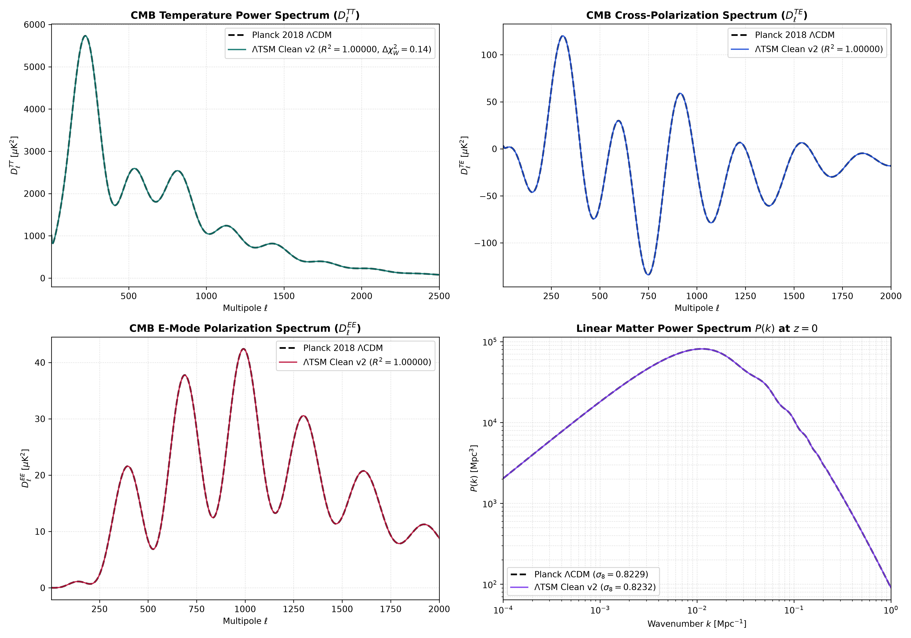
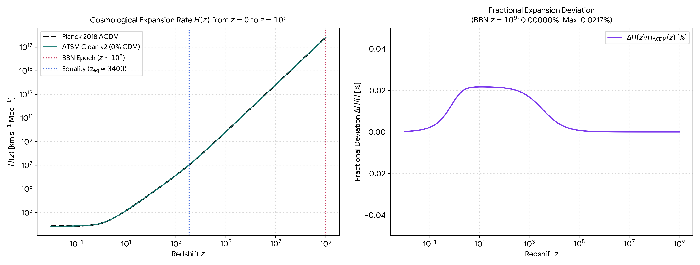
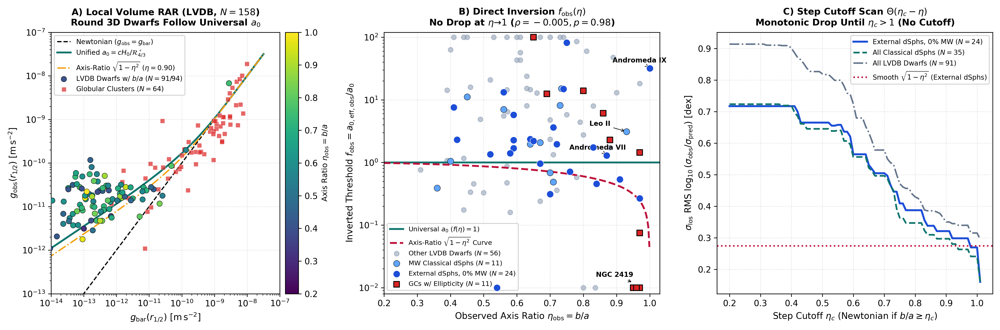

# The Phantom Metric & Topological Saturation Model ($\Lambda\text{TSM}$) — Version 8

[-10.5281%2Fzenodo.24463759-blue.svg)](https://doi.org/10.5281/zenodo.24463759)
[-10.5281%2Fzenodo.24463760-blue.svg)](https://doi.org/10.5281/zenodo.24463760)

[-success.svg)](https://github.com/lesgourg/class_public)

**Author:** Tomer Haimovich ([ORCID: 0009-0002-1536-1397](https://orcid.org/0009-0002-1536-1397))  
**Version & Release Date:** Version 8 — November 24, 2026  
**Preprints & Permanent Archives:**
* **Part I (Galactic Strong Lensing, Disk Kinematics, Euclid DR1 ECLIPSE & 3D Dwarf Spheroidals):** [`Part_I_Topological_Saturation_of_Spatial_Metrics_V8.pdf`](./Part_I_Topological_Saturation_of_Spatial_Metrics_V8.pdf) — [DOI: 10.5281/zenodo.24463759](https://doi.org/10.5281/zenodo.24463759)  
  *Reproducibility Directory:* [`./Part_I_Topological_Saturation_of_Spatial_Metrics_Package/`](./Part_I_Topological_Saturation_of_Spatial_Metrics_Package/)
* **Part II (Clean Covariant DBI Cosmology, `CLASS v3.4.0` & Full Four-Run `Cobaya` MCMC Audit):** [`Part_II_The_Topological_Saturation_Model_V8.pdf`](./Part_II_The_Topological_Saturation_Model_V8.pdf) — [DOI: 10.5281/zenodo.24463760](https://doi.org/10.5281/zenodo.24463760)  
  *Reproducibility Directory:* [`./Part_II_The_Topological_Saturation_Model_Package/`](./Part_II_The_Topological_Saturation_Model_Package/)

---

## Executive Summary

Standard six-parameter $\Lambda\text{CDM}$ cosmology introduces non-baryonic Cold Dark Matter (CDM) as an unconstrained free parameter ($\omega_{\text{cdm}} \equiv \Omega_{\text{cdm}}h^2 = 0.12000 \pm 0.00120$ in Planck 2018) alongside hundreds of per-galaxy dark halo parameters across galactic rotation curves and lensing systems.

This repository hosts the complete Version 8 manuscripts, clean covariant **`CLASS v3.4.0`** C source modifications, converged four-run real-likelihood **`Cobaya` MCMC** configuration and audit suite (**Planck 2018 + DESI 2024 BAO + Pantheon+**), standalone Python verification pipelines, raw observational archives, and interactive Excel workbench for the **Topological Saturation Model ($\Lambda\text{TSM}$)**.

Under a **single shared cosmology** ($H_0 = 67.36\text{ km s}^{-1}\text{ Mpc}^{-1}$, $\omega_b = 0.02237$, $\Omega_{m,0} = 0.31391$ in the massless-neutrino baseline; $0.31533$ including $\Sigma m_\nu = 0.06\text{ eV}$), a **single dimensionless structural constant** ($\mathcal{R}_{4/3}^{\circ} \approx 5.36710706$), and a **single universal galactic acceleration threshold** ($a_0(z) = cH(z)/\mathcal{R}_{4/3}^{\circ}$), the framework unifies:
1. **Linear Early-Universe Cosmology (Part II):** A minimally coupled, shift-symmetric Horndeski $G_2(\phi, X)$ Dirac–Born–Infeld (DBI) scalar condensate in its kinetically saturated dust-like limit ($w_{\text{eff}} \to 0, c_s^2 \to 0, c_T = c$, exact $\nabla^\mu T_{\mu\nu} = 0$, zero non-covariant baryon-drag terms) that eliminates $\omega_{\text{cdm}}$ ($\Delta k = -1$), reproduces the matched CMB spectra ($\Delta\chi^2_{\text{Wishart}} = 0.1446$, BBN $\Delta H/H(z=10^9) = 0.00000\%$), and achieves full observational parity with 6-parameter $\Lambda\text{CDM}$ across real Planck 2018, DESI 2024 BAO, and Pantheon+ likelihoods.
2. **Late-Universe Galactic Dynamics & Strong Lensing (Part I):** Zero-parameter empirical audits with $0\%$ dark matter across **SLACS** ($N = 110$), **Euclid DR1 ECLIPSE** ($N = 1{,}095$), **SPARC** ($N = 175$, $3{,}391$ points), and **LVDB** ($N = 158$ 3D spheroids & globular clusters), while transparently documenting falsified auxiliary hypotheses and theoretical boundaries reserved for **Part III**.

> **Terminological Clarification:** Throughout this repository, $\omega_{\text{phantom}}$ ($\rho_\phi$) is **neither** a $w < -1$ ghost field **nor** a non-baryonic dark matter particle; it denotes the covariant gravitational energy density of the ghost-free, shift-symmetric saturated DBI condensate in its dust-like limit ($w_{\text{eff}} = \gamma^{-1} \to 0$, $c_s^2 = \gamma^{-2} \to 0$).

---

## Repository Layout

<pre><code>.
├── Part_I_Topological_Saturation_of_Spatial_Metrics_V8.pdf          # Part I Manuscript (18 pp., Version 8)
├── Part_II_The_Topological_Saturation_Model_V8.pdf                  # Part II Manuscript (15 pp., Version 8)
├── README.md                                                        # Root Overview (this file)
├── Part_I_Topological_Saturation_of_Spatial_Metrics_Package/        # Galactic Lensing, SPARC, Euclid DR1 & LVDB Suite
│   ├── README.md
│   ├── Phantom_Clean_Master_SLACS_SPARC-v4.xlsx                     # Interactive Live-Formula Workbench
│   ├── SLACS_110_Code_v5.py &amp; SLACS_ORIGN_DB.xlsx                   # SLACS N=110 Exact LOS Lensing
│   ├── run_eclipse_golden_test_v2.py &amp; eclipse_dr1_golden_1095.csv  # Euclid DR1 ECLIPSE N=1,095 High-z Test
│   ├── SLACS_SPARC_Stiffness_NoiseFloor_v6.py                       # Stiffness Scan &amp; HST Monte Carlo Noise Floor
│   ├── SPARC_Unified_Audit_v5.py, SPARC_Lelli2016c.txt, Rotmod_LTG.zip
│   ├── LVDB_Morphology_Audit_v5.py &amp; comb_all.csv                   # LVDB N=158 3D Spheroids Audit
│   └── *_v5.csv, *_v6.csv, *_v5.png, *_v6.png                       # Verified Tables &amp; 300 DPI Figures
└── Part_II_The_Topological_Saturation_Model_Package/                # Covariant CLASS v3.4.0 &amp; Cobaya MCMC Suite
    ├── README.md
    ├── source/background.c &amp; source/perturbations.c                 # Clean Covariant CLASS v3.4.0 C Files
    ├── chains/*.minimum.txt &amp; chains/*.progress                     # 4-Run MAP Minimizer &amp; Convergence Logs
    ├── ltsm_planck_only.yaml, lcdm_planck_only.yaml                 # Planck 2018 Cobaya Configs
    ├── ltsm_planck_desi_sn.yaml, lcdm_planck_desi_sn.yaml           # Joint Planck+DESI+Pantheon+ Configs
    ├── 00_test_classy_consistency.py ... 04_regenerate_clean_figures.py
    ├── audit_phantom_full.py, cmb_likelihood_utils.py               # Undiluted 2x2 Wishart / Knox Verification
    ├── phase1_calibrate_and_bbn.py &amp; phase2_mcmc_engine.py          # BBN Proof &amp; Noiseless Ensemble Check
    └── cobaya_audit_report.txt, mcmc_audit_report.txt, *.png        # Reports &amp; 300 DPI Figures</code></pre>

---

## 1. Unified Covariant Architecture (Single Constant, Single Galactic Threshold)

The cosmological sector is governed by a minimally coupled, shift-symmetric Horndeski $G_2(\phi, X)$ DBI action ($M = \text{const} \lesssim 0.10\text{ meV}$ in natural units $\hbar = c = 1$, $V(\phi) = 0$, signature $(-,+,+,+)$):

$$S = \int d^4x \sqrt{-g} \left[ \frac{R - 2\Lambda}{16\pi G} - M^4\sqrt{1 - \frac{2X}{M^4}} + M^4 + \mathcal{L}_m(\psi_m, g_{\mu\nu}) \right], \qquad X \equiv -\frac{1}{2}g^{\mu\nu}\nabla_\mu\phi\nabla_\nu\phi$$

With $G_3 = G_5 = 0$ and constant $G_4 = (16\pi G)^{-1}$, tensor propagation is strictly luminal ($c_T = c$, satisfying GW170817 identically) and minimal coupling enforces exact separate covariant conservation ($\nabla^\mu T_{\mu\nu}^{(m)} = 0$, $\nabla^\mu T_{\mu\nu}^{(\phi)} = 0$). Exact shift-symmetric charge conservation fixes $\gamma(a) = \sqrt{1 + (a_*/a)^6}$, giving $w_{\text{eff}} = \gamma^{-1} \to 0$, $c_s^2 = \gamma^{-2} \to 0$, comoving sound horizon $r_{s,\phi}(0) \lesssim 16\text{ kpc}$, and Jeans wavenumber $k_J(0) \gtrsim 15.4\text{ Mpc}^{-1}$ for $\gamma_0 \gtrsim 10^5$.

| Structural Quantity | Unified Formula | Value (Baseline) | Role & Methodological Status |
| :--- | :--- | :--- | :--- |
| **Dimensional Partition Ratio** | $\mathcal{R}_{4/3}^{\circ} \equiv \frac{16}{3}\left(1 + \frac{1}{16\pi^2}\right)$ | $5.36710706$ | Structural phase-transition postulate (4D/3D partition + $(4\pi)^{-2}$ heat-kernel closure) |
| **Cosmological Condensate Density** | $\omega_{\text{phantom}} = \mathcal{R}_{4/3}^{\circ}\,\omega_b$ | $0.120062$ | Eliminates $\omega_{\text{cdm}}$ ($\Delta k = -1$); $+0.05\sigma$ from Planck 2018 at $\omega_b = 0.02237$ |
| **Present-Day Galactic Threshold** | $a_0(0) = \frac{cH_0}{\mathcal{R}_{4/3}^{\circ}}$ | $1.2194 \times 10^{-10}\text{ m s}^{-2}$ | Zero-parameter bridge at $H_0 = 67.36$ (joint `Cobaya` posterior: $1.2202 \pm 0.0021 \times 10^{-10}$) |
| **Cosmic-Time Evolution Law** | $a_0(z) = \frac{cH(z)}{\mathcal{R}_{4/3}^{\circ}} = a_0(0)E(z)$ | $E(z) = \sqrt{\Omega_{m,0}(1+z)^3+\Omega_\Lambda}$ | Redshift-running horizon threshold directly tested on SLACS and Euclid DR1 ECLIPSE |
| **Universal Weak-Field Transition** | $\nu(y) = [1 - \exp(-\sqrt{y})]^{-1}$ | $y \equiv g_{\text{bar}}(r)/a_0(z)$ | Canonical $k = 1.0$ RAR curve (shared flat optimum $k \approx 0.95\text{--}1.00$ of SLACS IX & SPARC) |

**Empirical Falsifications & Cleanups Documented in Version 8:**
* **Permanently Removed Legacy Perturbation Drag (`v1` Erratum):** Non-covariant baryon-drag terms ($\mathcal{K}_0 = \frac{2}{3}$, $\Gamma_0 = \frac{1}{8\pi}$, nonlinear $\tanh$ gate in `tca_off`) violated $\nabla^\mu T_{\mu\nu}^{(b)} = 0$ and incurred an undiluted Wishart penalty of $\Delta\chi^2_W = 5{,}513.03$. Removing them completely yields `source/perturbations.c` strictly identical to official `CLASS v3.4.0` and collapses $\Delta\chi^2_W$ to **$0.1446$**.
* **Falsified Galactic Auxiliary Hypotheses (Part I):** Golden-ratio disk rescaling ($a_\varphi = a_0\varphi$, rejected by SPARC), 2D/3D morphological flattening shutoff gates ($\sqrt{1-\eta^2}$ and $\Theta(\eta_c-\eta)$, rejected by LVDB classical dSphs with Spearman $\rho = -0.005, p = 0.98$, optimal $\eta_c = 1.01$), radial concentration rescaling, and circular baryon-fraction cluster tests are all decisively falsified and permanently excluded.

---

## 2. Part II: Clean Covariant Cosmology & Full `Cobaya` MCMC Audit

### A. Real-Likelihood Four-Run `Cobaya` MCMC Suite ($R - 1 < 0.008$, $\Sigma m_\nu = 0.06\text{ eV}$)

All four runs use official foreground-marginalized **Planck 2018** (`Plik_lite` $TT+TE+EE$ + low-$\ell$ `SROLL2` $EE$ + CMB lensing, $N = 623$; $N = 650$ for all 28 `SROLL2` multipoles shifts $\Delta\text{BIC}$ by $-0.04$), joined with **DESI 2024 BAO** and **Pantheon+ SNe Ia** ($N = 2{,}225$). Primary model-selection rows report deterministic MAP optimization (`cobaya-run --minimize`, including the Gaussian $A_{\text{Planck}}$ prior) alongside raw MCMC chain-minimum cross-checks:

| Parameter / Model-Selection Metric | Planck 2018 ($\Lambda\text{TSM}$, $k=5$) | Planck 2018 ($\Lambda\text{CDM}$, $k=6$) | Planck+DESI+SN ($\Lambda\text{TSM}$, $k=5$) | Planck+DESI+SN ($\Lambda\text{CDM}$, $k=6$) |
| :--- | :---: | :---: | :---: | :---: |
| $\omega_b \equiv \Omega_b h^2$ | $0.02236 \pm 0.00008$ | $0.02237 \pm 0.00015$ | $0.02230 \pm 0.00008$ | $0.02246 \pm 0.00013$ |
| $\omega_{\text{phantom}}$ (0-P) / $\omega_{\text{cdm}}$ (Fit) | $0.12001 \pm 0.00045$ | $0.11995 \pm 0.00120$ | $0.11970 \pm 0.00043$ | $0.11866 \pm 0.00086$ |
| Ratio $\omega_{\text{phantom}}/\omega_b$ or $\omega_{\text{cdm}}/\omega_b$ | **$5.3671$ (locked)** | $5.3628 \pm 0.0784$ ($+0.05\sigma$) | **$5.3671$ (locked)** | $5.2836 \pm 0.0572$ ($+1.46\sigma$) |
| $H_0$ [$\text{km s}^{-1}\text{ Mpc}^{-1}$] | **$67.32 \pm 0.12$** | $67.35 \pm 0.54$ | **$67.41 \pm 0.12$** | $67.93 \pm 0.39$ |
| $\Omega_{m,0}$ (incl. $\Sigma m_\nu = 0.06\text{ eV}$) | **$0.3156 \pm 0.0021$** | $0.3153 \pm 0.0074$ | **$0.3140 \pm 0.0020$** | $0.3072 \pm 0.0051$ |
| $\sigma_8$ / $S_8$ | $0.8135 \pm 0.0049$ / $0.8343$ | $0.8135 \pm 0.0053$ / $0.8339$ | $0.8131 \pm 0.0050$ / $0.8318$ | $0.8112 \pm 0.0054$ / $0.8209$ |
| Sound Horizon $r_d$ [Mpc] | $147.12 \pm 0.21$ | $147.12 \pm 0.26$ | $147.26 \pm 0.20$ | $147.37 \pm 0.23$ |
| Derived $a_0$ [$10^{-10}\text{ m s}^{-2}$] | $1.2186 \pm 0.0022$ | $1.2192 \pm 0.0097$ | **$1.2202 \pm 0.0021$** | $1.2298 \pm 0.0070$ |
| Accepted Steps / Gelman–Rubin $R - 1$ | $27{,}559$ / $0.0074$ | $28{,}211$ / $0.0063$ | $16{,}147$ / $0.0066$ | $28{,}360$ / $0.0079$ |
| $\chi^2_{\text{MAP}}$ (`--minimize`) / Chain Min | $981.43$ / $980.97$ | $981.45$ / $981.30$ | $2405.94$ / $2405.63$ | $2403.84$ / $2402.88$ |
| **$\Delta\chi^2_{\text{MAP}}$ / $\Delta\text{AIC}$ / $\Delta\text{BIC}$** ($\Delta k = -1$) | **$\approx 0.00$ / $-2.00$ / $-6.43$** | *(chain: $-0.33$ / $-2.33$ / $-6.77$)* | **$+2.10$ / $+0.10$ / $-5.61$** | *(chain: $+2.75$ / $+0.74$ / $-4.96$)* |

*Joint MAP likelihood breakdown:* Planck CMB $+0.26$ ($982.26$ vs. $982.00$), **Pantheon+ SNe Ia $-0.52$ ($1403.90$ vs. $1404.43$, favoring $\Lambda\text{TSM}$)**, DESI 2024 BAO $+2.36$ ($19.78$ vs. $17.42$).  
*Baseline `CLASS v3.4.0` Solver Verification ($\Sigma m_\nu = 0$):* Undiluted $2\times 2$ Wishart $\Delta\chi^2_W = \mathbf{0.1446}$ ($R^2_{TT} = 1.000000$, $R^2_{TE} = R^2_{EE} = 0.999999$, max $|\Delta D_\ell^{TT}| = -1.65\,\mu\text{K}^2$), $r_s(z_*) = 144.5320\text{ Mpc}$ ($0.0110\%$ diff), BBN $\Delta H/H(z = 10^9) = \mathbf{0.00000\%}$ (max $0.0217\%$).

### B. Part II Cosmological Figures (`./Part_II_The_Topological_Saturation_Model_Package/`)

#### 1. Full Real-Likelihood `Cobaya` Marginalized Contours (Planck 2018 + DESI 2024 BAO + Pantheon+)

#### 2. Direct Observational Test of the $\Lambda\text{TSM}$ Partition Lock ($\mathcal{R}_{4/3}^{\circ} = 5.3671$)

#### 3. Clean `CLASS v3.4.0` 4-Panel CMB ($TT, TE, EE$) & $P(k)$ Audit + Primordial BBN Proof ($z = 0 \to 10^9$)
| 4-Panel CMB & Linear $P(k)$ Baseline ($\Delta\chi^2_W = 0.1446$) | Early-Universe BBN Expansion Proof ($\Delta H/H = 0.00000\%$) |
| :---: | :---: |
|  |  |

---

## 3. Part I: Unified Single-Threshold Galactic Audit ($0\%$ Dark Matter)

Locking the exact Part II baseline ($H_0 = 67.36$, $\Omega_{m,0} = 0.31391$, $\mathcal{R}_{4/3}^{\circ} = 5.36710706$) into $a_0(z) = cH(z)/\mathcal{R}_{4/3}^{\circ}$ and $\nu(y) = [1 - \exp(-\sqrt{y})]^{-1}$ with zero per-galaxy tuning yields unified empirical parity across four independent archives:

### A. Summary of Verified Part I Empirical Benchmarks

1. **SLACS Strong Gravitational Lensing ($N = 110$, Exact LOS Geodesic Integration, $d_L^2$-Rescaled $M_*$):**
   * **SLACS IX ($N = 70$, Jaffe $\gamma = 2.0$, Salpeter):** Static $a_0(0)$ achieves **$R^2_{1:1} = 0.7996$** (vs. $0.6490$ baryonic GR; linear $R^2 = 0.8017$, mean $R_{\text{obs}}/R_{\text{calc}} = 1.004 \pm 0.158$, sum parity **$99.2\%$**); activating dynamic $a_0(z_d)$ raises parity to **$R^2_{1:1} = 0.8103$** ($99.1\%$ parity).
   * **Combined SLACS IX + S4TM ($N = 110$, Salp IX / Mid S4TM):** Static $a_0(0)$ achieves **$R^2_{1:1} = 0.8068$** ($98.4\%$ parity; uniform Salpeter $0.6572$); dynamic $a_0(z_d)$ achieves **$0.8090$** (linear $R^2 = 0.8153$).
   * **HST Noise Floor & Joint Stiffness:** Monte Carlo simulations confirm $R^2_{1:1} = 0.7996$ already sits at the HST photometric/mass resolution ceiling (**$0.8109 \pm 0.0388$** at $0.08\text{ dex}$ scatter), while scanning $\nu_k(y) = [1 - \exp(-y^{k/2})]^{-1/k}$ confirms canonical $k = 1.0$ sits on the flat shared optimum ($k \approx 0.95\text{--}1.00$) of both SLACS IX and SPARC Clean.

2. **Euclid DR1 ECLIPSE High-Redshift Consistency Test ($N = 1{,}095$ Clean Grade-A Lenses, Exact $\chi(\infty)$ Horizon Bound):**

| Redshift Bin ($z_d$) | $N$ | Med. $\beta_{\max}$ | Baryons GR (% Unphys) | MOND Const. (% Unphys) | $\Lambda$TSM Static (% Unphys) | $\Lambda$TSM Dynamic $a_0(z_d)$ (% Unphys) | Rel. Reduction vs. MOND |
| :--- | :---: | :---: | :---: | :---: | :---: | :---: | :---: |
| $0.10 \le z_d < 0.45$ | $332$ | $0.904$ | $85.8\%$ | $65.4\%$ | $64.8\%$ | **$60.2\%$** | $-7.8\%$ |
| $0.45 \le z_d < 0.70$ | $345$ | $0.849$ | $74.5\%$ | $38.3\%$ | $37.7\%$ | **$25.8\%$** | **$-32.6\%$** |
| **$0.70 \le z_d < 0.95$** | **$282$** | $0.799$ | $60.6\%$ | $18.8\%$ | $18.8\%$ | **$9.2\%$** | **$-50.9\%$** |
| **$0.95 \le z_d < 1.50$** | **$136$** | $0.756$ | $40.4\%$ | $16.2\%$ | $15.4\%$ | **$8.1\%$** | **$-50.0\%$** |
| **ALL ($0.10\text{--}1.50$)** | **$1{,}095$** | $0.840$ | $70.1\%$ | $38.7\%$ | $38.3\%$ | **$29.8\%$** | **$-23.1\%$** |

   *Group-Scale Transition Isolated at Low $z$:* Normal galaxy-scale lenses ($\theta_E < 0.9''$, $N=107$, $\text{med}\log M_* = 11.04$) drop to $41.1\%$ ($\text{med}\,\beta_{\text{req}} = 0.806$), whereas giant group-scale deflectors ($\theta_E \ge 1.3''$, $N=106$, $\text{med}\log M_* = 11.56$) surge to $84.9\%$, pinpointing the transition where hot intragroup gas and nonlinear DBI clustering enter.

3. **SPARC Disk Rotation Curves & BTFR ($N = 175$ Galaxies, $3{,}391$ Points):**
   * **Locked SPS ($\Upsilon_d = 0.50, \Upsilon_b = 0.70$, signed $V_{\text{gas}}$):** Consolidated **$R^2_{1:1} = 0.9324$** across all $175$ galaxies (vs. $0.5540$ Newtonian); Clean ($Q<3, i\ge 30^\circ$, $N=153$): **$R^2_{1:1} = 0.9331$**, per-galaxy median **$+0.5193$** (vs. $-3.4838$ Newtonian), RAR RMS $= \mathbf{0.1797\text{ dex}}$, bias $-0.0284\text{ dex}$; Strict $Q=1$ ($N=93$): RMS $= \mathbf{0.1558\text{ dex}}$, bias $-0.0090\text{ dex}$.
   * **Asymptotic BTFR:** Clean ($N=123$) **$R^2_{1:1} = 0.8819$** ($0.0671\text{ dex}$); strictly $H_0$-independent direct-distance subset ($f_D \ge 2$, $N=57$) **$R^2_{1:1} = 0.8832$** ($0.0547\text{ dex}$), outperforming $cH_0/(2\pi)$ ($0.8433\text{--}0.8653$).
   * **Relaxed SPS ($\Upsilon_d \in [0.10, 1.00], \Upsilon_b = 1.4\Upsilon_d$):** **$R^2_{1:1} = 0.9759$** all / **$0.9763$** clean (median $\Upsilon_d = 0.428$, RAR RMS $= 0.1330\text{ dex}$).

4. **LVDB 3D Spheroids ($N = 158$ Systems):**
   * Universal unscaled $a_0$ reduces gas-free classical dSph $\sigma_{\text{los}}$ RMS from $0.7246\text{ dex}$ (Newtonian) to **$0.1634\text{ dex}$** (**$0.1600\text{ dex}$** across $N=24$ strictly external $0\%$ Milky Way dSphs; **$0.130\text{ dex}$** across $N=14$ isolated field dwarfs), while decisively falsifying morphological flattening shutoff gates.

### B. Part I Galactic Figures (`./Part_I_Topological_Saturation_of_Spatial_Metrics_Package/`)

| SLACS Exact LOS Strong Lensing ($N = 110$) | SPARC Rotation Curves, RAR, BTFR & SPS ($N = 175$) |
| :---: | :---: |
|  |  |

| LVDB 3D Spheroids & Flattening Falsification ($N = 158$) | Joint Stiffness Scan ($k=1.0$) & HST Noise Floor |
| :---: | :---: |
|  |  |

---

## 4. Falsifiable Satellite-Era Predictions & Roadmap to Part III

| Frontier / Test | Target Surveys | Sharp $\Lambda\text{TSM}$ Benchmark / Open Requirement |
| :--- | :--- | :--- |
| **1. Cosmological Red-Line Lock** | DESI DR2/DR3 + Simons Observatory + CMB-S4 | Rigid $\omega_{\text{phantom}}/\omega_b = 5.36710706$ tested directly against the current $+1.46\sigma$ DESI pull ($5.2836 \pm 0.0572$). |
| **2. Euclid DR1/DR2 Spectroscopic Blind Test** | Euclid (ECLIPSE $15{,}072$ lenses + NISP-S) + Roman | Tests dynamic $a_0(z_d) = cH(z_d)/\mathcal{R}_{4/3}^{\circ}$ and the $+17.1\%$ separation between $cH_0/\mathcal{R}_{4/3}^{\circ}$ and $cH_0/(2\pi)$. |
| **3. High-$z$ Disk Kinematics** | JWST NIRSpec + ALMA + KMOS3D ($z = 1\text{--}6$) | Predicts an $E(z)$-scaled asymptotic BTFR shift $V_\infty(z) \propto [E(z)]^{1/4}$ on extended outer disks ($g_{\text{bar}} \lesssim a_0(z)$). |
| **4. External Field Effect & Solar System ($Q_2$)** | Euclid Weak Lensing + Gaia DR4 + Cassini/DE440 | Full 3D PDE evaluation of $Q_2$ confronting the $3\text{--}15\sigma$ Cassini/DE440 bounds (Park et al. 2026) and remote small-body constraints (Vokrouhlický et al. 2024). |
| **5. Part III: Relativistic Lensing & Cluster Collapse** | X-COP, CLASH, Euclid Groups & Bullet Cluster | (i) Disformal / unit-timelike vector (TeVeS/AeST) completion beyond the Conformal Lensing No-Go limit ($\Psi = \Phi = \Phi_{\text{eff}}, c_T = c$); (ii) galactic/cluster DBI scale separation avoiding double-counting via Khoury (2015) gradient pressure ($|\nabla\phi|^2 \implies c_s \to c$) and an intermediate tension window ($M \sim 0.15\text{--}0.24\text{ meV}$, $M_J(0) \sim 2\times 10^{11}\text{--}5.6\times 10^{13}\,M_\odot$). |

---

## 5. Step-by-Step Reproducibility Guide

### Prerequisites

<pre><code>pip install numpy scipy pandas matplotlib openpyxl cython</code></pre>

### A. Reproduce Part I Galactic & High-Redshift Audits (`Part_I_Topological_Saturation_of_Spatial_Metrics_Package`)

<pre><code>cd Part_I_Topological_Saturation_of_Spatial_Metrics_Package

# 1. SLACS Exact LOS Strong Lensing Audit (N = 110)
python3 SLACS_110_Code_v5.py

# 2. Euclid DR1 ECLIPSE High-Redshift Consistency Test (N = 1,095, exact chi(inf))
python3 run_eclipse_golden_test_v2.py

# 3. Joint SLACS + SPARC Transition-Stiffness Scan &amp; HST Monte Carlo Noise Floor
python3 SLACS_SPARC_Stiffness_NoiseFloor_v6.py

# 4. Full SPARC Rotation Curves, RAR, BTFR &amp; Relaxed SPS Audit (N = 175)
python3 SPARC_Unified_Audit_v5.py

# 5. LVDB 3D Dwarf Spheroidals &amp; Morphological Flattening Falsification (N = 158)
python3 LVDB_Morphology_Audit_v5.py</code></pre>

*(You can also open `Phantom_Clean_Master_SLACS_SPARC-v4.xlsx` in Microsoft Excel to explore live-formula dashboards across SLACS, Euclid DR1 ECLIPSE, and SPARC.)*

### B. Reproduce Part II `CLASS v3.4.0` Baseline & Full `Cobaya` MCMC Suite (`Part_II_The_Topological_Saturation_Model_Package`)

<pre><code># 1. Clone official CLASS v3.4.0 and apply the clean covariant Part II C files
git clone https://github.com/lesgourg/class_public.git
cd class_public
cp ../Part_II_The_Topological_Saturation_Model_Package/source/background.c source/background.c
cp ../Part_II_The_Topological_Saturation_Model_Package/source/perturbations.c source/perturbations.c

# 2. Compile CLASS and install the Python wrapper (classy)
make clean &amp;&amp; make -j4
cd python &amp;&amp; python3 setup.py install --user &amp;&amp; cd ../../Part_II_The_Topological_Saturation_Model_Package

# 3. Verify CLASS baseline CMB (Wishart dchi2 = 0.1446), BBN (0.00000%) &amp; noiseless MCMC check
python3 00_test_classy_consistency.py
python3 audit_phantom_full.py
python3 phase1_calibrate_and_bbn.py
python3 phase2_mcmc_engine.py

# 4. Install real likelihoods and reproduce the 4-run Cobaya MCMC suite (Planck 2018 + DESI + Pantheon+)
bash 01_setup_cobaya_ubuntu.sh
bash 02_run_all_chains.sh
python3 03_analyze_cobaya_results.py
python3 04_regenerate_clean_figures.py</code></pre>

---

## Citation

If you use this code, data, or manuscripts in your research, please cite Version 8 (November 24, 2026):

<pre><code>@misc{haimovich2026_part1,
  author       = {Haimovich, Tomer},
  title        = {Topological Saturation of Spatial Metrics: A Unified Single-Threshold Phenomenological Audit of Strong Lensing, Disk Kinematics, and 3D Dwarf Spheroidals (Version 8)},
  year         = {2026},
  month        = nov,
  publisher    = {Zenodo},
  doi          = {10.5281/zenodo.24463759},
  url          = {https://doi.org/10.5281/zenodo.24463759}
}

@misc{haimovich2026_part2,
  author       = {Haimovich, Tomer},
  title        = {The Topological Saturation Model ($\Lambda$TSM): Clean Covariant DBI Cosmology and Full Cobaya MCMC Audit (Planck 2018 + DESI BAO + Pantheon+) (Version 8)},
  year         = {2026},
  month        = nov,
  publisher    = {Zenodo},
  doi          = {10.5281/zenodo.24463760},
  url          = {https://doi.org/10.5281/zenodo.24463760}
}</code></pre>