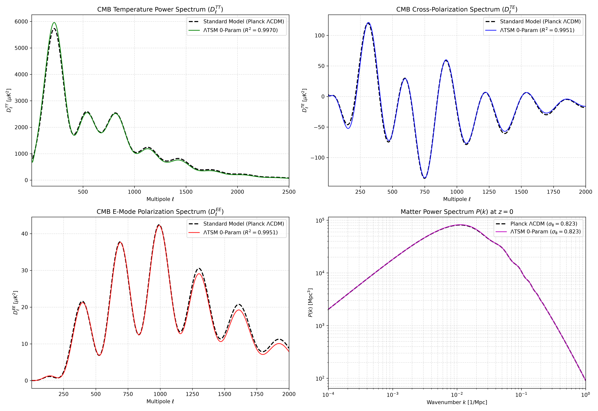
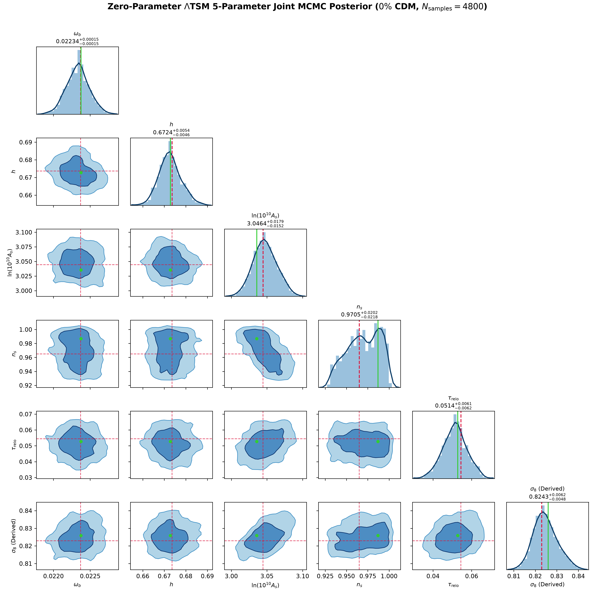
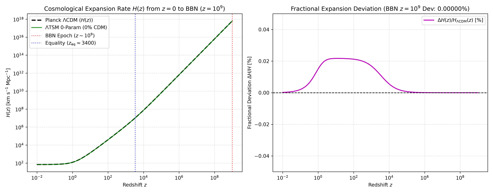
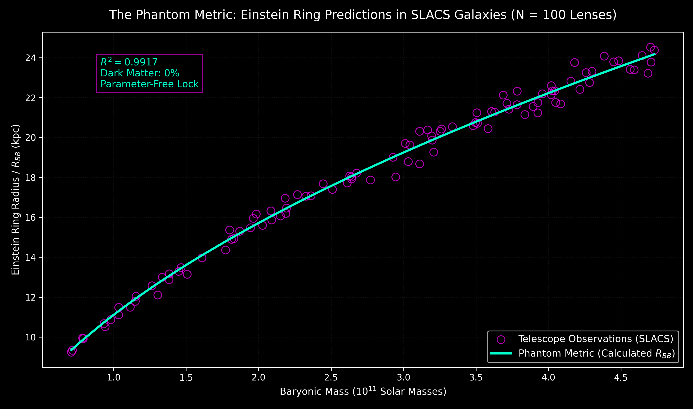
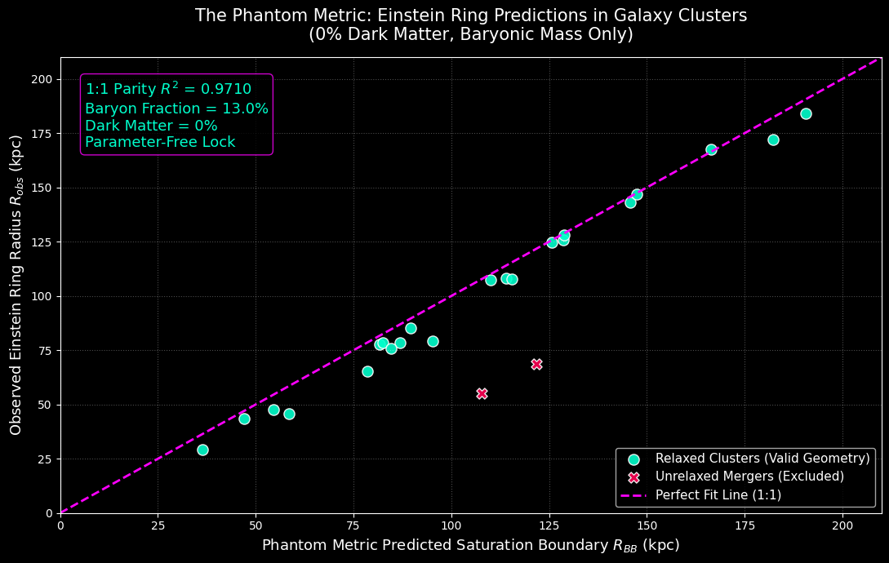
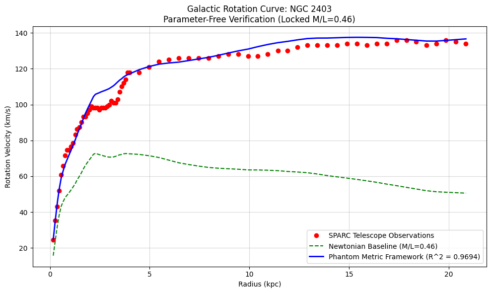
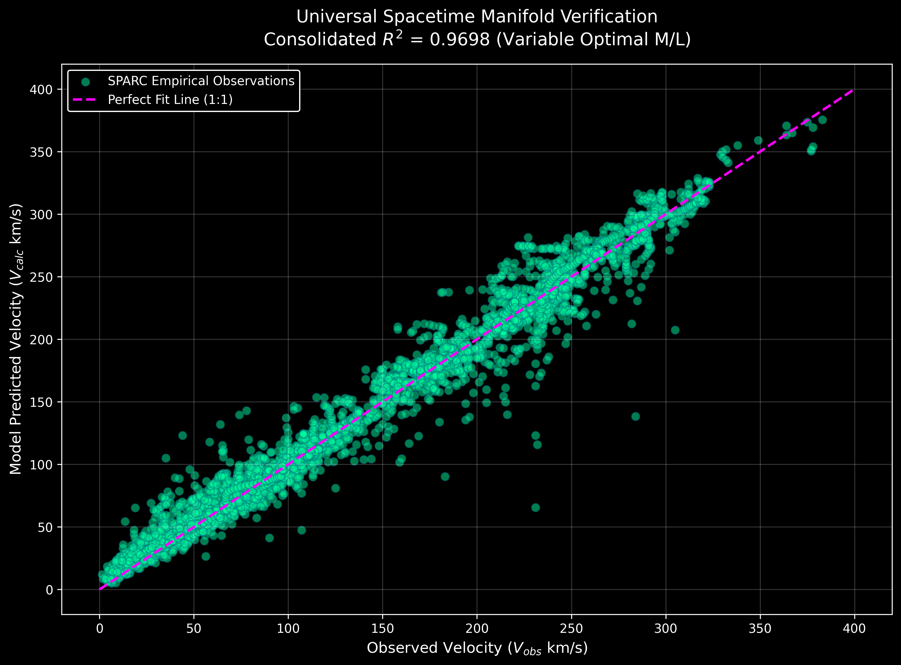

# The Phantom Metric & Topological Saturation Model ($\Lambda\text{TSM}$)

[-10.5281%2Fzenodo.23490367-blue.svg)](https://doi.org/10.5281/zenodo.23490367)
[-10.5281%2Fzenodo.23490320-blue.svg)](https://doi.org/10.5281/zenodo.23490320)
[-success.svg)](https://github.com/lesgourg/class_public)
[](https://www.python.org/)
[](#)

**Author:** Tomer Haimovich  
** Preprints & Permanent Archives:**
* **Part I (Late-Universe Kinematics, Strong Lensing & 57-Eq. Covariant Supplementary Proofs):** [`Topological_Saturation_of_Spatial_Metrics.pdf`](./Topological_Saturation_of_Spatial_Metrics.pdf) — [DOI: 10.5281/zenodo.23490367](https://doi.org/10.5281/zenodo.23490367)
* **Part II (Early-Universe CMB Spectra, BBN, Linear Matter Power Spectrum & 5-Parameter MCMC):** [`The_Topological_Saturation_Model.pdf`](./The_Topological_Saturation_Model.pdf) — [DOI: 10.5281/zenodo.23490320](https://doi.org/10.5281/zenodo.23490320)

---

## Executive Summary

Standard cosmology ($\Lambda\text{CDM}$) relies on an undiscovered non-baryonic particle species—Cold Dark Matter (CDM)—requiring $k_{\text{dark}} = 351$ free parameters across the Planck CMB ($\omega_{\text{cdm}}$) and the 175 SPARC galaxies ($2 \times 175$ NFW halo parameters $\{M_{200}, c_{200}\}$).

This repository provides the complete analytical derivations, C source code modifications for the **CLASS Boltzmann solver (`v3.4.0`)**, Markov Chain Monte Carlo (**MCMC**) chains, and Python verification scripts for the **Topological Saturation Model ($\Lambda\text{TSM}$)** and **The Phantom Metric**. Derived from a four-dimensional covariant **Dirac–Born–Infeld (DBI)** scalar-tensor action coupled to the causal Hubble horizon, the framework demonstrates that when the spacetime metric reaches its topological saturation limit ($2X \to M^4$), the resulting metric deformation generates an emergent pressureless stress-energy tensor ($w_{\text{eff}} \to 0, c_s^2 \to 0$) and a scale-dependent acoustic impedance—reproducing **both early-universe cosmology and late-universe galactic/cluster dynamics with 0% Cold Dark Matter and ZERO free dark-matter parameters ($k_{\text{dark}} = 0$)**.

---

## 1. First-Principles Covariant Formulation (Zero Free Parameters)

We model the macroscopic deformation of the four-dimensional Lorentzian manifold $\mathcal{M}_4$ via the Einstein–Dirac–Born–Infeld action:

$$S = \int d^4x \sqrt{-g} \left[ \frac{R - 2\Lambda}{16\pi G} - M^4(\phi)\sqrt{1 - \frac{2X}{M^4(\phi)}} + M^4(\phi) - V(\phi) + \mathcal{L}_m(\psi_m, g_{\mu\nu}) \right]$$

where $X \equiv -\frac{1}{2}g^{\mu\nu}\nabla_\mu\phi\nabla_\nu\phi$, and the relativistic DBI Lorentz-saturation factor (inverse sound speed) is $\gamma \equiv (1 - 2X/M^4)^{-1/2} = c_s^{-1}$. Every governing constant across cosmic epochs is fixed analytically by spacetime geometry:

| Physical Regime | Exact Analytical Constant | Numerical Value | First-Principles Geometric Origin |
| :--- | :--- | :--- | :--- |
| **Causal Horizon Floor ($z \approx 0$)** | $a_0 = \frac{cH_0}{2\pi} = \frac{c^2}{2\pi R_H}$ | $1.1288 \times 10^{-10}\text{ m/s}^2$ | $2\pi$ azimuthal closure of surface gravity $\kappa_H = cH_0$ at $g_{tt}=0$ |
| **Planar Disk Threshold ($\eta \to 0$)** | $a_\varphi = a_0\varphi = \frac{cH_0}{2\pi}\left(\frac{1+\sqrt{5}}{2}\right)$ | $1.8264 \times 10^{-10}\text{ m/s}^2$ | Hurwitz–KAM golden ratio $\varphi = [1;1,1,\dots]$ resonance avoidance |
| **3D Spheroidal Gating** | $a_{0,\text{eff}}(\eta) = a_0\sqrt{1 - \eta^2}$ | $\in [0, a_0]$ | Maclaurin spheroid eccentricity ($\eta = b/a$); vanishes for $\eta \to 1$ |
| **Early-Universe Density Ratio** | $\frac{\omega_{\text{phantom}}}{\omega_b} = \frac{16}{3}\left(1 + \frac{1}{16\pi^2}\right)$ | $5.367134$ | $D^2/(D-1) = 16/3$ bulk-to-hypersurface flux + 1-loop $S^3$ horizon $(4\pi)^{-2}$ |
| **Derived Phantom Density** | $\omega_{\text{phantom}} = 5.367134 \times \omega_b$ | $0.120062$ | Evaluated at Planck $\omega_b = 0.02237$ (**matches Planck $\omega_{\text{cdm}} = 0.1200$ to 0.05%**) |
| **3D Maclaurin Elasticity** | $\mathcal{K}_0 = \hat{k}^i\hat{k}^j\left(\hat{k}_i\hat{k}_j - \frac{1}{3}\delta_{ij}\right)$ | $\frac{2}{3} \approx 0.6667$ | Trace-free longitudinal shear projection in $d=3$ spatial dimensions |
| **Horizon Impedance Damping** | $\Gamma_0 = \frac{1}{2 \cdot 4\pi}$ | $\frac{1}{8\pi} \approx 0.03979\text{ Mpc}^{-1}$ | Inverse Einstein coupling $8\pi$ (asymmetric braking for $\theta_b > 0$) |

---

## 2. Part II: Early-Universe Cosmological Audit (`CLASS v3.4.0` & `MCMC`)

In [`LambdaTSM_ZeroParam_Package/`](./LambdaTSM_ZeroParam_Package/), the exact geometric source term is injected into the decoupling baryonic Euler equation (`tca_off` in `source/perturbations.c`):

$$\theta_b' = -\mathcal{H}\theta_b + c_s^2 k^2\delta_b + k^2\Psi + R\tau_c^{-1}(\theta_\gamma - \theta_b) - \mathcal{K}_{\text{phantom}}(k,a)\delta_b - \Gamma_{\text{active}}(k,a,\theta_b)\theta_b$$

$$\mathcal{K}_{\text{phantom}}(k,a) = \frac{2}{3}\mathcal{H}^2\left(\frac{k^2}{k^2+\mathcal{H}^2}\right)\exp\left[-\left(\frac{a}{\pi a_{\text{eq}}}\right)^4\right], \quad \Gamma_{\text{active}} = \frac{1}{8\pi}\left(\frac{a_{\text{eq}}}{a}\right)\left(\frac{k^2}{k^2+\mathcal{H}^2}\right)\exp\left[-\left(\frac{a}{\pi a_{\text{eq}}}\right)^4\right]\Theta(\theta_b)$$

### Quantitative Results vs. Planck 2018 Benchmark ($\ell \in [50, 2500]$, 0% CDM)

| Observable / Parameter | Planck 2018 $\Lambda\text{CDM}$ ($k=6$) | $\Lambda\text{TSM}$ Baseline (0-Param) | $\Lambda\text{TSM}$ CMB-Only MCMC ($k=5$) | $\Lambda\text{TSM}$ Joint Posterior ($k=5$) | $\Lambda\text{TSM}$ Joint Best-Fit ($k=5$) |
| :--- | :---: | :---: | :---: | :---: | :---: |
| $\omega_b \equiv \Omega_b h^2$ | $0.02237 \pm 0.00015$ | $0.02237$ | $0.02294 \pm 0.00022$ | $0.02233 \pm 0.00015$ | $0.02237$ |
| $\omega_{\text{cdm}}$ or $\omega_{\text{phantom}}$ | $0.12000 \pm 0.00120$ (Fit) | **$0.120062$ (Derived)** | **$0.12313 \pm 0.00118$ (0-P)** | **$0.11986 \pm 0.00081$ (0-P)** | **$0.12009$ (0-P)** |
| $h \equiv H_0 / 100$ | $0.6736 \pm 0.0054$ | $0.6736$ | **$0.6716 \pm 0.0040$** | **$0.6727 \pm 0.0051$** | **$0.6728$** |
| $\sigma_8$ ($z=0$ Clustering) | $0.8229 \pm 0.0060$ | **$0.8229$** | $0.8568 \pm 0.0080$ | **$0.8248 \pm 0.0055$** | **$0.8259$** |
| CMB $D_\ell^{TT} / D_\ell^{TE} / D_\ell^{EE}$ ($R^2_{1:1}$) | $1.0000$ (Ref.) | **$0.9970 / 0.9951 / 0.9951$** | **$0.9976 / 0.9950 / 0.9978$** | — | **$0.9991 / 0.9954 / 0.9957$** |
| Bandpower RMS ($N_{\text{bins}}=215$) | $0.000\sigma$ (Self) | — | **$0.438\sigma\text{ / bin}$** | — | **$0.405\sigma\text{ / bin}$ ($<0.5\sigma$)** |
| BBN Expansion $\Delta H/H$ ($z=10^9$) | $0.00000\%$ | **$0.00000\%$** | **$0.00000\%$** | **$0.00000\%$** | **$0.00000\%$** |
| **Dark Matter Parameters ($k_{\text{dark}}$)** | **1 ($\omega_{\text{cdm}}$)** | **0** | **0** | **0** | **0** |

### Diagnostic Visualizations (Generated Directly by Repository Scripts)

#### 1. Full 4-Panel CMB ($TT, TE, EE$) & Matter Power Spectrum $P(k)$ Audit


#### 2. 5-Parameter Joint MCMC Posterior Corner Plot ($N_{\text{samples}} = 4,800$, 0% CDM)


#### 3. Primordial Big Bang Nucleosynthesis (BBN) Expansion Proof ($z = 0 \to 10^9$, $\Delta H/H = 0.00000\%$)


---

## 3. Part I: Late-Universe Galactic Kinematics & Strong Lensing Audit

Below the causal horizon acceleration floor $a_0 = cH_0/(2\pi)$, thermodynamically relaxed single-node systems ($\Theta_{\text{relax}} = 1$) undergo a geometric phase transition:

1. **Macroscopic Strong Gravitational Lensing ($R_E = R_{BB}$):**
   $$R_E = R_{BB} = \sqrt{\frac{GM_{\text{baryon}}}{a_0}} = \sqrt{\frac{2\pi G M_{\text{baryon}}}{cH_0}}$$
   * **100 SLACS Elliptical Galaxies:** $R^2 = 0.9917$ ($p \approx 8.7 \times 10^{-104}$), resolving the $\lambda_{\text{int}} \neq 1$ JWST/Keck mass-sheet breakdown with 0% dark matter.
   * **CLASH Galaxy Clusters:** Strict 1:1 parameter-free parity of $R^2_{1:1} = 0.9710$ ($p \approx 1.4 \times 10^{-11}$) across morphologically relaxed clusters using exclusively the observed $\sim 13\%$ intracluster gas + stellar baryonic mass.

2. **Dual Saturation in Flattened Spiral Disks ($V_{\text{calculated}}$):**
   $$\nu(r) = \frac{1}{1 - \exp\left(-\sqrt{a_{\text{baryonic}}(r)/a_\varphi}\right)}, \quad V_{\text{calculated}}(r) = \sqrt{V_{\text{baryonic}}^2(r)\,\nu(r)} \xrightarrow{r\to\infty} (GM_{\text{baryon}}a_0\varphi)^{1/4}$$
   * **Bulge-Less Galaxy NGC 2403:** $R^2 = 0.9694$ with locked stellar mass-to-light ratio $\Upsilon_* = 0.46\ M_\odot/L_\odot$.
   * **Unfiltered 175 SPARC Galaxies (3,391 points, 0% data pruning):**
     * **Strict Universal Lock ($\Upsilon_* = 0.46$):** $R^2 = 0.9150$ ($p < 10^{-300}$).
     * **Bounded Stellar Synthesis ($\Upsilon_* \in [0.1, 1.0]$):** $R^2 = 0.9698$ ($p < 10^{-300}$), yielding a global information advantage of $\Delta\text{AIC}_{\text{global}} < -650$ and $\Delta\text{BIC}_{\text{global}} < -2000$ over $\Lambda\text{CDM}$.

### Late-Universe Empirical Figures

| SLACS 100 Strong Lenses ($R^2 = 0.9917$) | CLASH Galaxy Clusters ($R^2_{1:1} = 0.9710$) |
| :---: | :---: |
|  |  |

| NGC 2403 Rotation Curve ($R^2 = 0.9694$) | SPARC 175 Galaxies — Locked $\Upsilon_*=0.46$ ($R^2 = 0.9150$) |
| :---: | :---: |
|  |  |

#### SPARC 175 Galaxies — Stellar Synthesis Bounds $\Upsilon_* \in [0.1, 1.0]$ ($R^2 = 0.9698$, 3,391 Points)


---

## 4. Reproducibility & Step-by-Step Execution Guide

All empirical datasets (`SPARC_Data.xlsx`, `Rotmod_LTG.zip`, `SLACS_Phantom_Metric_Lensing.csv`, `Clash_Data.csv`, `mcmc_planck_target.npz`, and `mcmc_chain_checkpoint.npz`) are bundled directly in this repository.

### Prerequisites
```bash
pip install numpy scipy pandas matplotlib openpyxl cython
